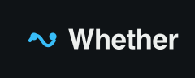
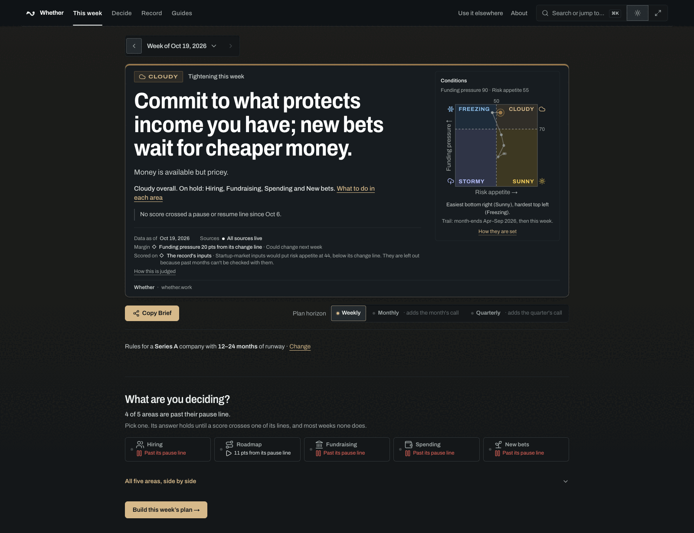
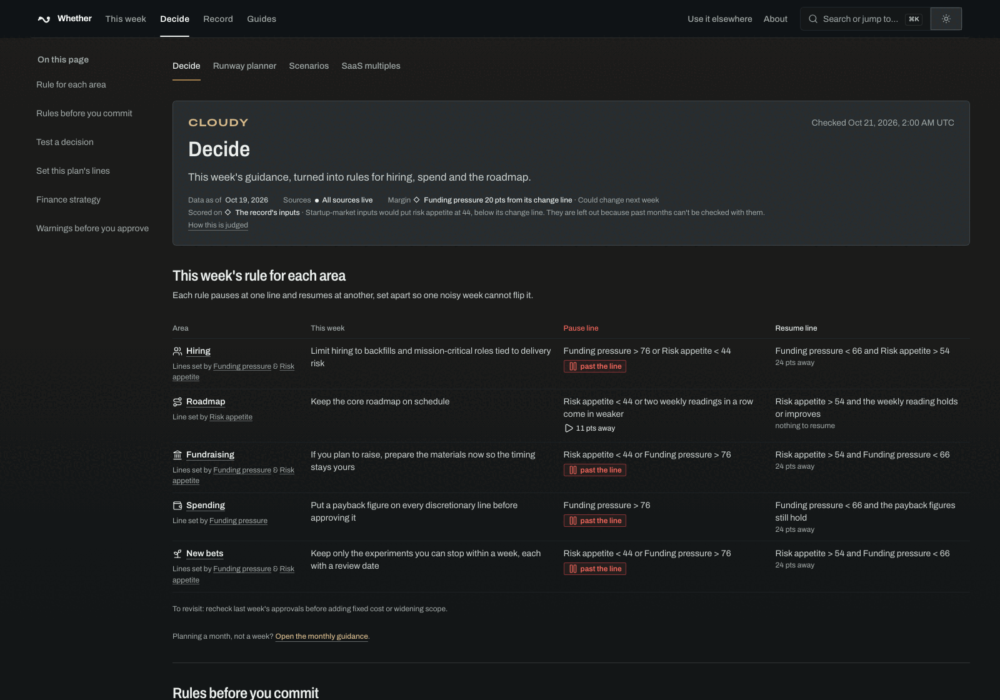
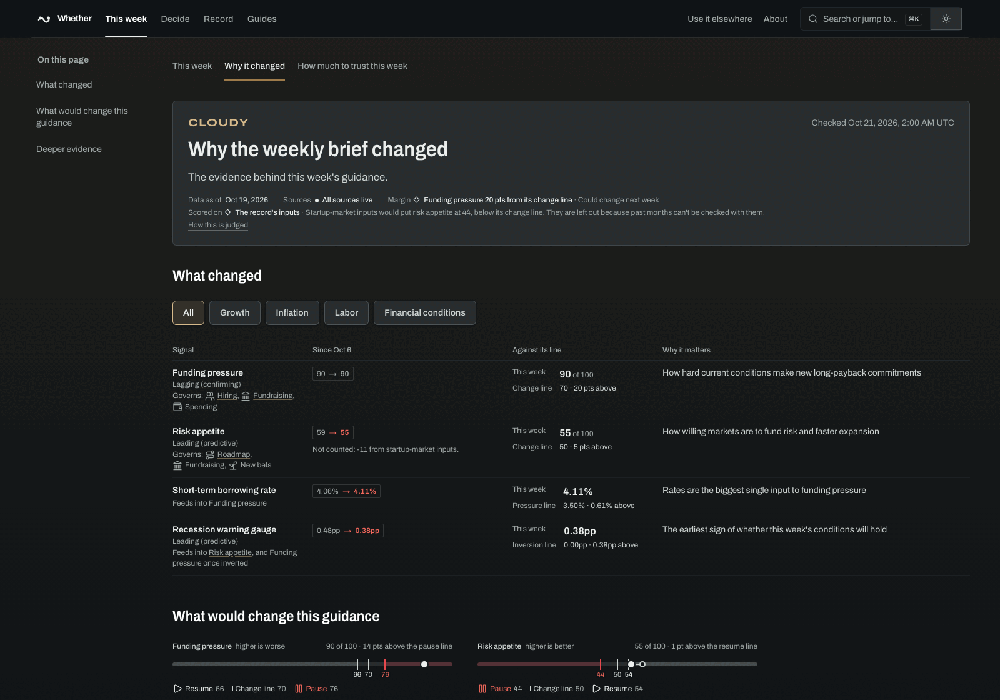
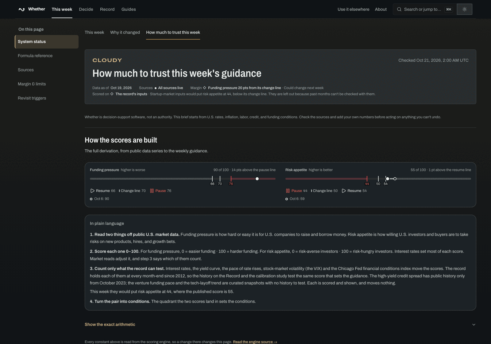
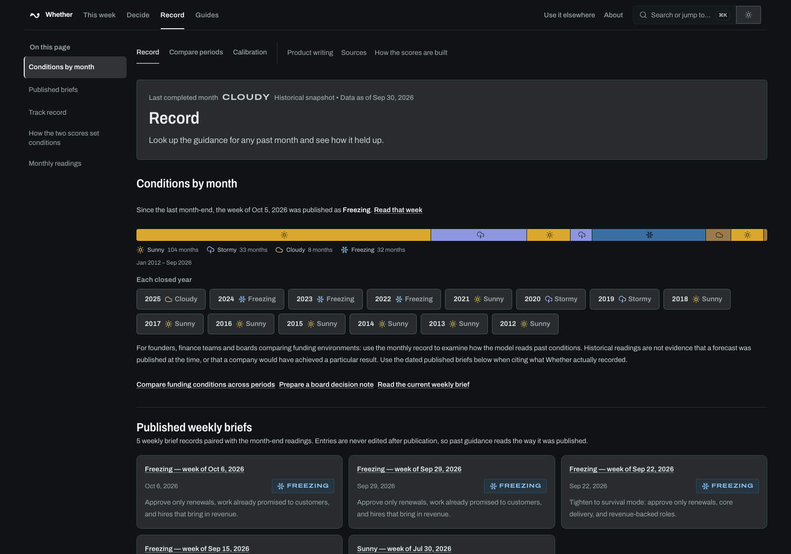
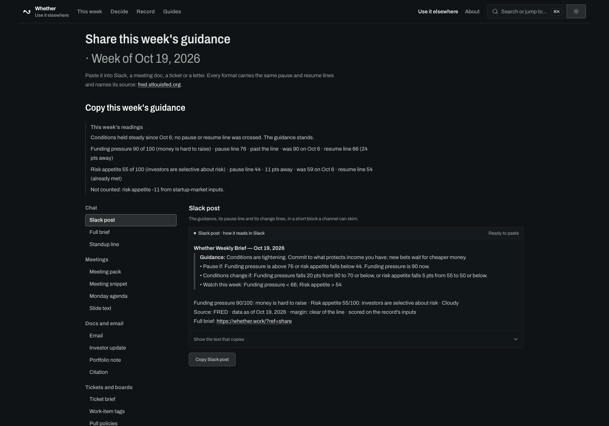
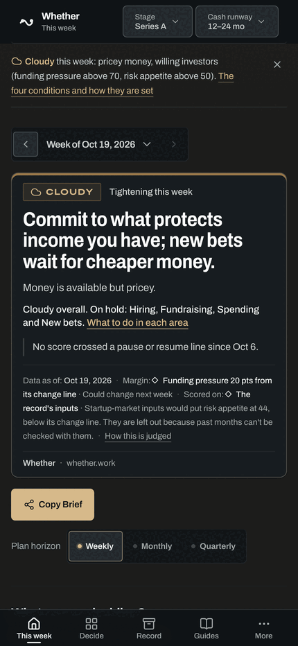

# Whether

<p align="center">
  
</p>

<h3 align="center">Weekly operating guidance for startup leaders</h3>

<p align="center">
  The interest-rate and credit lines that pause or resume your hiring, spend and raise. Checked every Monday, with an email the day one is crossed. Whether is free.
</p>

<p align="center">
  <a href="https://whether.work"></a>
  <a href="#connect-an-agent"></a>
  <a href="LICENSE"></a>
  <a href="https://github.com/zz-plant/whether/commits/main"></a>
</p>

<p align="center">
  <a href="https://whether.work"><strong>This week's brief</strong></a> ·
  <a href="https://whether.work/share#subscribe-email">Monday email</a> ·
  <a href="#try-it-without-installing">Try it in one command</a> ·
  <a href="#connect-an-agent">MCP &amp; agent API</a> ·
  <a href="docs/README.md">Documentation</a>
</p>

<p align="center">
  <picture>
    <source media="(prefers-color-scheme: light)" srcset="docs/assets/screens/weekly-brief-light.png" />
    
  </picture>
</p>

---

## How it works

Whether scores two things from public U.S. market data every Monday:

- **Funding pressure (0–100):** how hard it is for U.S. companies to raise and borrow money. Higher is worse.
- **Risk appetite (0–100):** how willing investors and buyers are to back new products, hires and growth. Higher is better.

Together the two scores place the week in one of four conditions: `Sunny`, `Cloudy`, `Stormy` or `Freezing`. Interest rates, the yield curve, the pace of rate rises, stock-market volatility and the Chicago Fed financial conditions index move the scores, because the record holds each of them at every month-end since 2012. Inflation, labor, the high-yield credit spread and startup-market inputs are shown beside them and move nothing.

Each decision area gets an action for this week, a **pause line** that holds it back and a **resume line**, set apart from the pause line so one noisy week cannot flip it. Three rows from the brief for the week of Oct 19, 2026, in Cloudy conditions:

| Area | This week | Pause line | Resume line |
| :--- | :--- | :--- | :--- |
| **Hiring** | Limit hiring to backfills and mission-critical roles tied to delivery risk | Funding pressure &gt; 76 or risk appetite &lt; 44 | Funding pressure &lt; 66 and risk appetite &gt; 54 |
| **Spending** | Put a payback figure on every discretionary line before approving it | Funding pressure &gt; 76 | Funding pressure &lt; 66 and the payback figures still hold |
| **Fundraising** | If you plan to raise, prepare the materials now so the timing stays yours | Risk appetite &lt; 44 or funding pressure &gt; 76 | Risk appetite &gt; 54 and funding pressure &lt; 66 |

The live brief at `/` fits the actions to a company's stage and cash runway. Every number traces to its formula and source on `/trust`.

---

## The product

| | |
| :--- | :--- |
|  |  |
| **Decide** (`/operate`): this week's rule for each area, the work to stop and start, and a runway planner. | **Why it changed** (`/signals`): each reading since the last brief, measured against the lines it governs. |
|  |  |
| **Trust** (`/trust`): how each score is built, where each feed comes from and when it last updated. | **Record** (`/history`): conditions by month since 2012, every published brief, and how past calls held up. |
|  | <picture><source media="(prefers-color-scheme: light)" srcset="docs/assets/screens/weekly-brief-mobile-light.png" /></picture> |
| **Share** (`/share`): the week's guidance as a Slack post, email, meeting slide, ticket or investor update. | **On a phone:** the same brief at 430px. |

Captured from whether.work on Oct 21, 2026. [docs/assets/README.md](docs/assets/README.md) says how to recapture them.

---

## Quick start

### Try it without installing

Every endpoint is public and needs no key or account:

```bash
curl https://whether.work/brief.md
```

That prints this week's brief as Markdown: the conditions, the guidance, and each decision with its pause and resume lines. For the same reading as about 3KB of JSON, with each score against its lines:

```bash
curl "https://whether.work/api/agent?view=state"
```

### Run locally

```bash
git clone https://github.com/zz-plant/whether.git
cd whether
bun install
bun run dev
```

Open [http://localhost:3000](http://localhost:3000). Without network access the brief falls back to the snapshots in `data/` and says so.

### Use the CLI

```bash
bun run cli:whether -- status
bun run cli:whether -- brief slack
bun run cli:whether -- watch --changes-only
```

`status` prints this week's conditions and call, `brief slack` prints the Slack post, and `watch` refreshes until a score moves. Pass `--api-base-url https://whether.work` to read production. [docs/cli-command-reference.md](docs/cli-command-reference.md) lists every command.

### Connect an agent

In Claude Code:

```bash
claude mcp add --transport http whether https://whether.work/api/mcp
```

In Cursor or VS Code, one click: [Add to Cursor](https://cursor.com/install-mcp?name=whether&config=eyJ1cmwiOiJodHRwczovL3doZXRoZXIud29yay9hcGkvbWNwIn0%3D) · [Add to VS Code](https://vscode.dev/redirect/mcp/install?name=whether&config=%7B%22type%22%3A%22http%22%2C%22url%22%3A%22https%3A%2F%2Fwhether.work%2Fapi%2Fmcp%22%7D)

Any other MCP client takes the same URL:

```json
{
  "mcpServers": {
    "whether": {
      "url": "https://whether.work/api/mcp"
    }
  }
}
```

Or run the server locally over stdio with `bun run mcp:whether`. Agents should call `get_state` first. The tools, the manifest at [`/.well-known/whether-agent.json`](https://whether.work/.well-known/whether-agent.json) and [`/llms.txt`](https://whether.work/llms.txt) are all generated from `lib/agent/tools.ts`; [docs/agents/agent-interface.md](docs/agents/agent-interface.md) covers the rest.

The REST endpoints, their parameters and the ones that need a header are in [docs/developer/api-reference.md](docs/developer/api-reference.md); [whether.work/api-docs](https://whether.work/api-docs) is the public version.

### Embed this week's call

Paste two lines into any page, such as a team wiki, an investor portal or an internal dashboard:

```html
<div data-whether-embed="brief"></div>
<script async src="https://whether.work/embed.js"></script>
```

`brief` draws the guidance and each area's action; `call-strip` draws a single line. The block updates when the brief does and links back to the full reading. The builder at [whether.work/share](https://whether.work/share) adds a company stage and previews the result.

---

## Under the hood

- **One registry, every agent surface.** Each tool is defined once in `lib/agent/tools.ts`. The HTTP and stdio MCP servers, the plain-GET shim, the manifest and `/llms.txt` all read from it, and `tests/agentDiscoveryParity.test.ts` fails if any of them drifts.
- **An engine that reads no data and writes no words.** `lib/regimeEngineScoring.ts` turns inputs into codes. Every sentence a reader sees comes from `lib/report/`, and an architecture test rejects any engine import of copy, React or data files. A change to scoring bumps `ENGINE_VERSION`.
- **Fallback that says so.** If a feed fails or goes stale, the brief draws from the snapshots in `data/` and labels the reading with its date and the reason.
- **A record you can audit.** Conditions are scored at every month-end since 2012 by the same engine the live brief runs, so a past call can be checked against what followed.
- **Fast, strict gates.** The 2,500+ tests run in about 14 seconds on Bun. The pre-push gate rejects new `as` casts, new lint suppressions and exports with no caller.

---

## Development

| Command | What it runs | Time |
| :--- | :--- | :--- |
| `bun run dev` | Dev server with hot reload (Vinext on Cloudflare Workers) | — |
| `bun run test <path>` | One test file | ~0.2s |
| `bun run test` | The full suite, 2,500+ tests | ~14s |
| `bun run typecheck` | TypeScript 7 (native) | ~5s |
| `bun run lint` | oxlint, warnings denied | ~1s |
| `bun run build` | The production Worker bundle | — |
| `bun run check` | Lint, types, tests, assets, audit and landmark checks, concurrently | ~50s |

`check` also runs on `git push` through `.husky/pre-push`, and that hook is the gate: the GitHub workflows run only by hand. [CLAUDE.md](CLAUDE.md) lists every command and what each costs; [AGENTS.md](AGENTS.md) holds the rules a change has to meet.

---

## Codebase map

```
whether/
├── app/                  # Routes and UI
│   ├── page.tsx          # The weekly brief
│   ├── operate/          # Decide: rules per area, runway planner, scenarios
│   ├── signals/          # Why it changed: the evidence behind the scores
│   ├── trust/            # Sources, freshness and formulas
│   ├── history/          # The record: conditions by month, published briefs
│   ├── share/            # Every copy, file and image format of the brief
│   └── api/              # JSON API, MCP server, images and cron handlers
├── lib/
│   ├── regimeEngine.ts   # Scores the week and names its condition
│   ├── macroSnapshot.ts  # Treasury and FRED ingestion, with fallback
│   ├── report/           # Brief assembly and every reader-facing sentence
│   ├── export/           # Slack, email, slide, deck and investor-update builders
│   ├── alert/            # Alerts between Mondays, by email and Slack
│   └── agent/            # The tools every agent surface reads
├── data/                 # Fallback snapshots
├── docs/                 # Product specs, editorial rules and agent guides
└── tests/                # The suite
```

---

## Place in the revisable delegation loop

Whether holds the **act** step in the [STD-07 Revisable Delegation Record](https://ethotechnics.org/standards/std-07-revisable-delegation-record) loop. It turns changed conditions into weekly operating guidance, and the operator acts. It authorizes nothing and takes no action itself.

- **Export:** a reader's saved decisions in STD-07 shape at `GET /api/decision-memory?format=records`, as newline-delimited JSON, SHA-256 chained, oldest first. The endpoint returns only the requesting owner's records.
- **Conformance:** Level 2 (append-only, hashed, chained), declared in [`/.well-known/whether-agent.json`](https://whether.work/.well-known/whether-agent.json).
- **Siblings:** [Ambit](https://github.com/zz-plant/ambit) (capability and authorization), [Refract](https://github.com/refract-org/refract) (discrepancy), [NextConsensus](https://nextconsensus.com) (belief), [Ethotechnics](https://ethotechnics.org) (record shape and vocabulary).

---

## Documentation

- [docs/README.md](docs/README.md): the documentation hub, routed by task
- [docs/use-cases/operator-playbooks.md](docs/use-cases/operator-playbooks.md): workflows by role
- [docs/editorial-guardrails.md](docs/editorial-guardrails.md): vocabulary, decision contracts and tone
- [docs/one-screen-weekly-brief-spec.md](docs/one-screen-weekly-brief-spec.md): the weekly brief's specification
- [docs/developer/quickstart.md](docs/developer/quickstart.md): integrating with the API
- [ROADMAP.md](ROADMAP.md): what has shipped and what is next
- [CONTRIBUTING.md](CONTRIBUTING.md) and [AGENTS.md](AGENTS.md): how changes are made here
