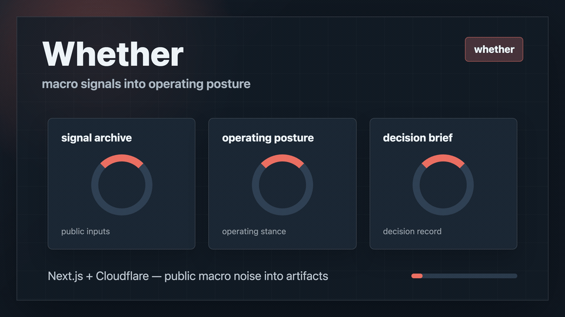
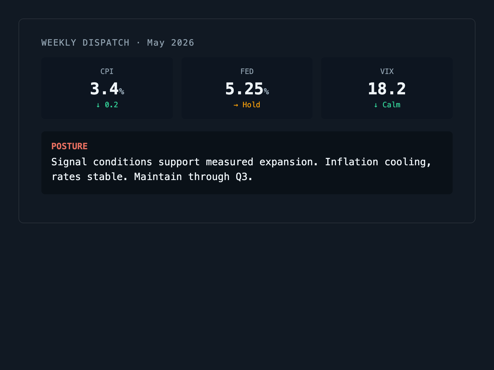
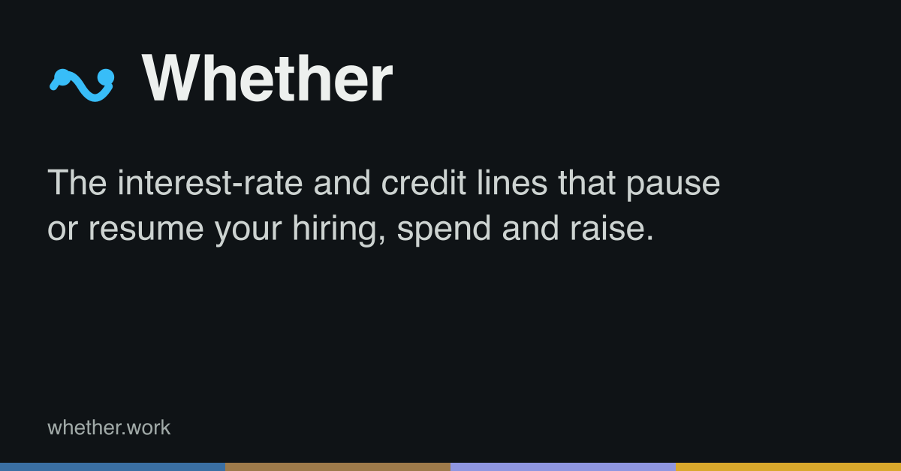
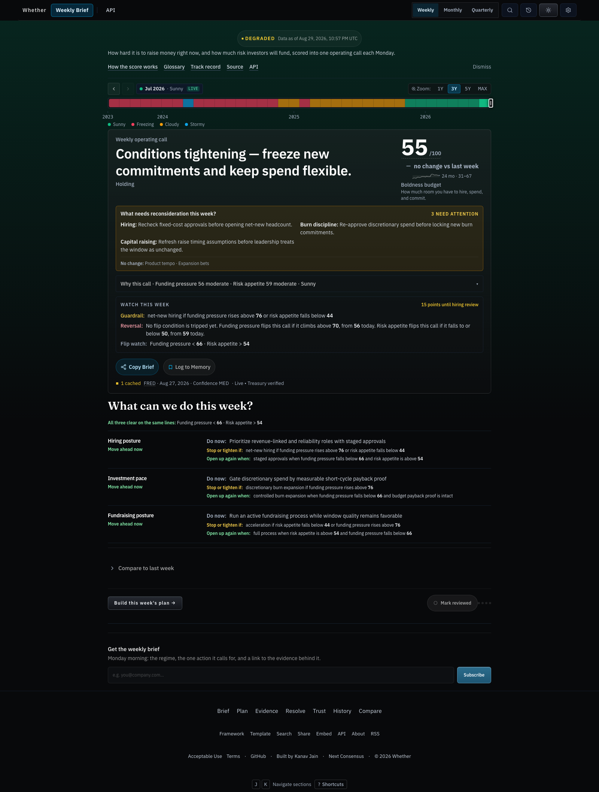
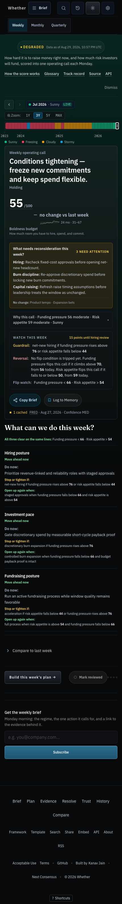
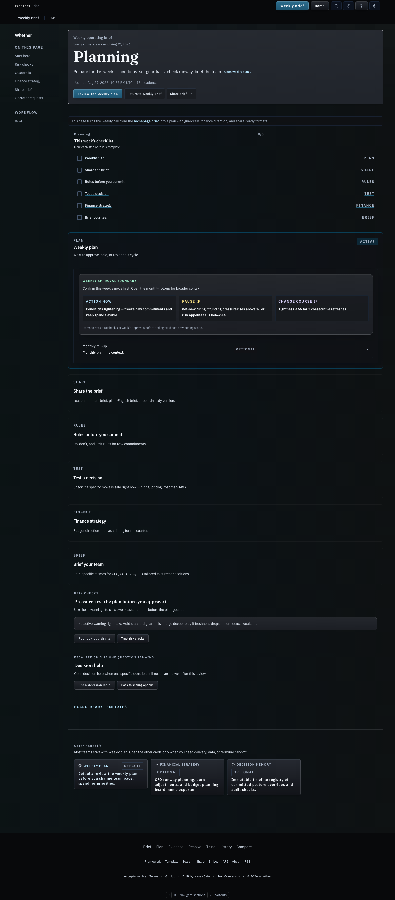
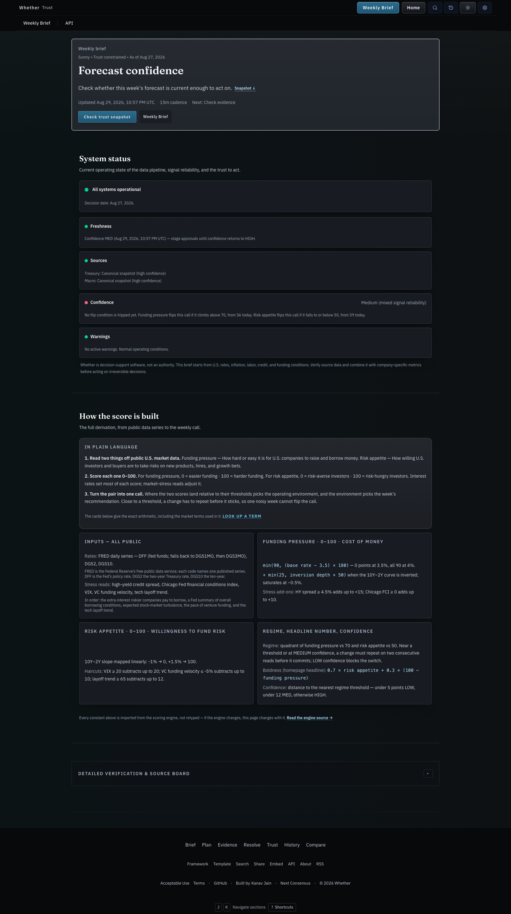
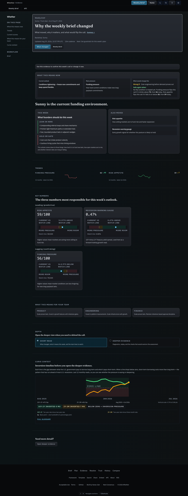
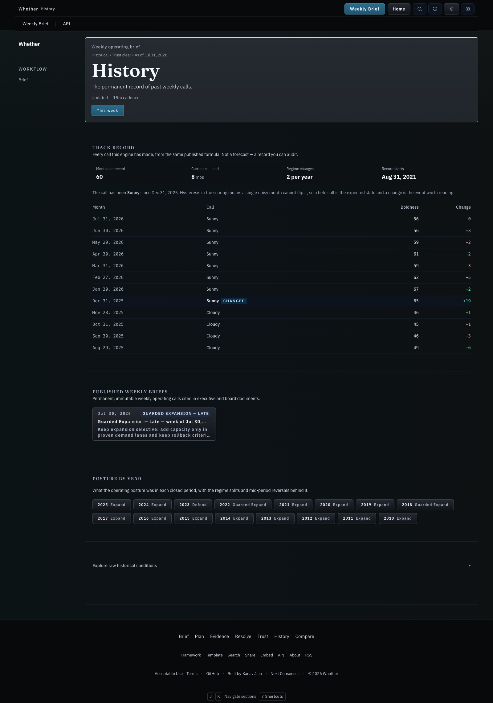

# Whether

<p align="center">
  
</p>

<h3 align="center">The weekly operating call for startup leaders</h3>

<p align="center">
  How aggressively should your company hire, spend, raise, and expand this week?
</p>

<p align="center">
  <a href="https://whether.work"><strong>Explore Live Brief</strong></a> ·
  <a href="#quickstart">Quickstart</a> ·
  <a href="docs/use-cases/operator-playbooks.md"><strong>Operator Playbooks</strong></a> ·
  <a href="#mcp--agent-integration">MCP &amp; Agent API</a> ·
  <a href="#why-whether-succeeds">Core Pillars</a> ·
  <a href="docs/README.md">Documentation</a>
</p>

<p align="center">
  
</p>

---

## The Core Operating Loop

Whether turns public macro and capital-market data into a **weekly operating call** for startup and product leaders:

$$\text{signals} \longrightarrow \text{posture} \longrightarrow \text{decisions} \longrightarrow \text{artifact}$$

Everything in this product is designed for **decision transmission** — enabling an operator to scan the brief, choose an operating posture, and share a meeting-ready artifact in **under 60 seconds**.

<p align="center">
  
</p>

---

## Why Whether Succeeds

### 1. The 60-Second Operating Call & Boldness Budget

Instead of raw market charts or macroeconomic commentary, Whether compresses market physics into a single stance:

- **Operating Regimes**: Freezing / Cloudy / Stormy / Sunny (translated into operating stances: *Contraction*, *Transitional Mixed*, *Guarded Expansion*, *Expansion*).
- **Boldness Budget (0–100)**: A calibrated weekly score of how much operating aggressiveness current capital-market conditions support.
  - **Higher budget** $\rightarrow$ faster approvals, more experimentation, greater willingness to hire and expand fixed costs.
  - **Lower budget** $\rightarrow$ shorter payback requirements, greater reversibility, tighter commitments.

```
+-----------------------------------------------------------------------------+
|  REGIME: GUARDED EXPANSION (Sunny)                 BOLDNESS BUDGET: 62/100  |
|  "Stage decisions. Avoid irreversible fixed-cost commitments."              |
+-----------------------------------------------------------------------------+
```

---

### 2. Bounded Decisions over Generic Advice

Generic advice says *"be cautious."* Whether delivers **bounded decisions** — explicit triplets containing an **Action**, a **Threshold/Trigger**, and a **Reversal Condition**:

| Decision Area | Do now (Action) | Stop / tighten if (Threshold) | Open back up when (Reversal) |
| :--- | :--- | :--- | :--- |
| **Engineering & Product** | Fund initiatives with &lt;6-month payback | Yield curve inversion deepens &gt; 15 bps | 2 consecutive refreshes with stable spreads |
| **Hiring & Headcount** | Backfill revenue-critical roles only | BBB spreads widen &gt; 220 bps | Cash availability index returns above 65 |
| **Fundraising & Runway** | Maintain 18+ months forward runway | VIX stays &gt; 28 for &gt; 10 trading days | Volatility subsides and rate cuts materialize |

---

### 3. Meeting-Ready & Slack-Ready Artifacts

Decision clarity is incomplete without frictionless distribution. Every brief generates copy-ready, permalink-backed artifacts for Monday morning rituals:

<p align="center">
  
</p>

- **Slack Brief**: Markdown-ready summary formatted for executive and team channels (`whether brief slack`).
- **Leadership Pack**: Formatted slides and bulleted recaps for board and leadership syncs.
- **Attributable Permalinks**: Every shared artifact links to a permanent, frozen citable record (`https://whether.work/brief/2026-w34`).

<p align="center">
  
</p>

---

### 4. Compact Trust & Data Provenance (`/trust`)

No black boxes. Every calculation is auditable in real-time with compact trust indicators:

- **Live Sensor Feeds**: Direct public series links to the Federal Reserve (FRED) and US Treasury (Yield Curve, CPI, Unemployment, BBB Spreads, Chicago FCI, VIX).
- **Formula Transparency**: Published math and hysteresis thresholds at [`/trust#formula-reference`](https://whether.work/trust#formula-reference).
- **Graceful Degradation**: Clear visual markers (`isLive`, `isFallback`) when upstream feeds degrade, ensuring offline safety and zero silent failures.

---

### 5. First-Class Agent & Developer Platform

Whether is designed from the ground up to be consumed by human operators and AI agents alike:

- **Native Model Context Protocol (MCP)**: Query the live brief directly within Cursor, Claude Desktop, Antigravity, or any MCP client via `https://whether.work/api/mcp`.
- **JSON API Endpoints**: Deterministic payloads for scripts, dashboards, and automated workflows.
- **Terminal CLI (`whether`)**: Full terminal workflow for engineers and operators.

```bash
# Query the live weekly operating brief
curl -s "https://whether.work/api/weekly" | jq '.summary'
```

---

## Visual Tour: Key Operator Surfaces

<p align="center">
  <em>The complete loop: from one-screen weekly briefs to operational checklists, verifiable trust, and historical track record.</em>
</p>

| Surface | Preview | Primary Job |
| :--- | :--- | :--- |
| **Weekly Brief** (`/`) |  | 60-second leadership operating posture, Boldness Budget, and bounded decisions. |
| **Mobile Brief** (`/` on mobile) |  | Responsive, high-compression mobile layout for quick scanning before Monday standups. |
| **Operations Hub** (`/operate`) |  | Role-based execution constraints, runway planners, and export generators. |
| **Trust & Provenance** (`/trust`) |  | Live feed status, freshness SLAs, formula reference, and active warning monitors. |
| **Evidence Appendix** (`/signals`) |  | Deep sensor breakdown for Treasury yield curve, inflation, labor, and credit spreads. |
| **Track Record** (`/history`) |  | Multi-year historical replay, regime transition diffs, and calibration audit logs. |

---

### 1) Run locally

```bash
bun install
bun run dev
```

Open [http://localhost:3000](http://localhost:3000) to view the local weekly brief.

### 2) Run from the CLI

```bash
# Read current status
bun run cli:whether -- status

# Generate Slack brief
bun run cli:whether -- brief slack

# Watch for regime changes
bun run cli:whether -- watch --changes-only
```

See [docs/cli-command-reference.md](docs/cli-command-reference.md) for all CLI commands.

### 3) Connect MCP (Model Context Protocol)

Add Whether to your MCP client configuration:

```json
{
  "mcpServers": {
    "whether": {
      "url": "https://whether.work/api/mcp"
    }
  }
}
```

Or run locally over stdio:

```bash
bun run mcp:whether
```

---

## Development & Testing

| Task | Command | Description |
| :--- | :--- | :--- |
| **Dev Server** | `bun run dev` | Starts local dev server with hot reload |
| **Lint** | `bun run lint` | Runs ESLint across all app and lib files |
| **Typecheck** | `bun run typecheck` | Validates TypeScript contracts |
| **Targeted Test** | `bun test tests/homeBriefModel.test.ts` | Runs single test file (~0.2s) |
| **Full Test Suite** | `bun run test` | Runs entire regression suite |
| **Build** | `bun run build` | Builds production Worker bundle via Vinext |
| **Full Gate** | `bun run check` | Runs lint, typecheck, tests, and assets |

---

## Architecture & Codebase Map

```
whether/
├── app/                  # Next.js / Vinext routes and UI surfaces
│   ├── page.tsx          # Homepage: The one-screen Weekly Brief
│   ├── operate/          # Operations hub, scenario planning & action checklists
│   ├── signals/          # Evidence appendix & sensor breakdown
│   ├── trust/            # Data provenance, freshness SLAs & formulas
│   └── api/              # JSON API routes, MCP server & webhook handlers
├── lib/
│   ├── report/           # Brief data assembly, Boldness Budget, and knobs
│   ├── regimeEngine.ts   # Core macro scoring & regime classification
│   ├── macroSnapshot.ts  # Live FRED / Treasury feed ingestion & fallback
│   ├── briefBuilders.ts  # Slack, email, and meeting artifact formatting
│   └── navigation/       # Information architecture & routing definitions
└── docs/                 # Product specs, editorial guardrails & agent guides
```

---

## Documentation Links

- **[docs/use-cases/operator-playbooks.md](docs/use-cases/operator-playbooks.md)**: Role-specific operator workflows, playbooks & recipes
- **[docs/README.md](docs/README.md)**: Canonical documentation hub
- **[docs/editorial-guardrails.md](docs/editorial-guardrails.md)**: Vocabulary, decision contracts, and tone
- **[docs/one-screen-weekly-brief-spec.md](docs/one-screen-weekly-brief-spec.md)**: Core brief UI/UX specification
- **[docs/developer/quickstart.md](docs/developer/quickstart.md)**: Integration guide and API reference
- **[AGENTS.md](AGENTS.md)**: Guidelines for AI pair programming

---

## Where Whether sits

Whether is one of five systems that each hold a step of the loop an institution runs when it delegates consequential work to machines: believe, know what can be done, decide what authority is justified, act, detect mismatch, revise. Whether holds the **act** step. It turns changed conditions into a weekly operating call; the operator acts. It authorizes nothing and takes no action itself.

- **Canonical export**: the decision memory ledger, in the [STD-07 Revisable Delegation Record](https://ethotechnics.org/standards/std-07-revisable-delegation-record) shape at `GET /api/decision-memory?format=records` (newline-delimited JSON, SHA-256 chained, oldest first). Every record is a `belief`: the regime read at the time, and the call that depended on it, with the assumption snapshot restated as the conditions that would invalidate it.
- **Conformance**: Level 1 (append-only, hashed, chained). Declared in [`/.well-known/whether-agent.json`](https://whether.work/.well-known/whether-agent.json) under `revisableDelegation`.
- **Wired to**: nothing yet. No sibling consumes these records and Whether consumes none. The manifest's `upstream` and `downstream` arrays are empty on purpose and fill in only when an edge exists in code.
- **Siblings**: [Ambit](https://github.com/zz-plant/ambit) (capability and authorization), [Refract](https://github.com/refract-org/refract) (discrepancy), [NextConsensus](https://nextconsensus.com) (belief), [Ethotechnics](https://ethotechnics.org) (the record shape and the vocabulary).

---

## Stance & Philosophy

- **Operating guidance, not financial advice**: Whether is built to pace organizational hiring, burn, and expansion — not pick stocks.
- **Delta first**: We emphasize what changed, what that flips in your decisions, and what would reverse the call.
- **Artifacts over dashboards**: The end state of an analysis is a shared decision in Slack or a meeting, not an unread portal.
