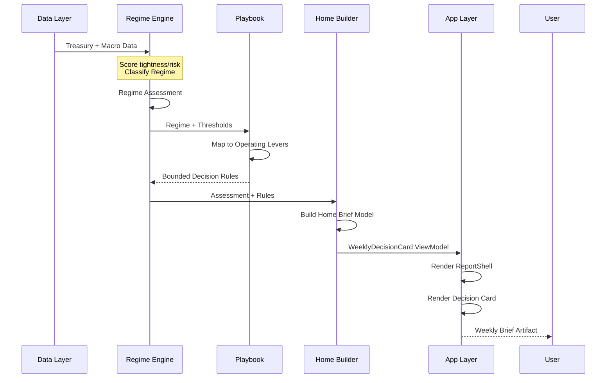
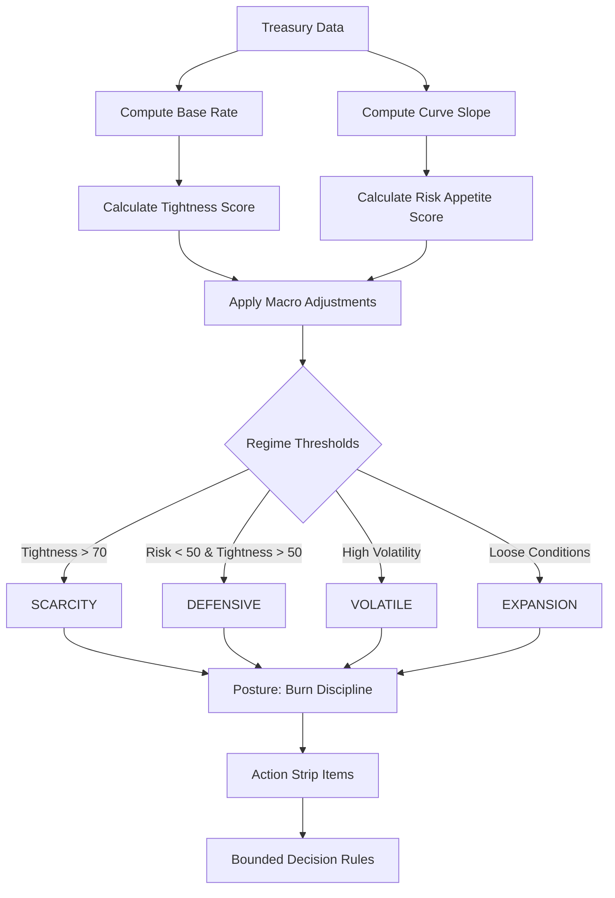
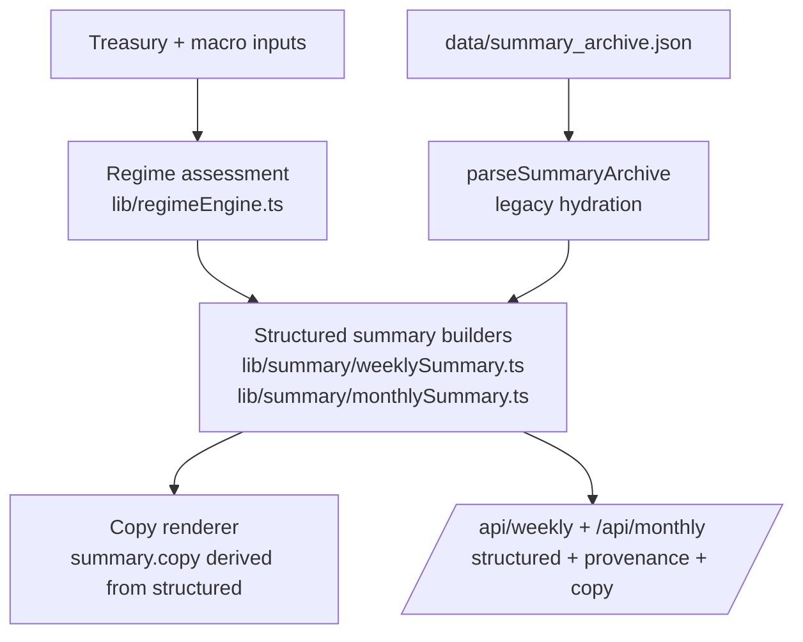
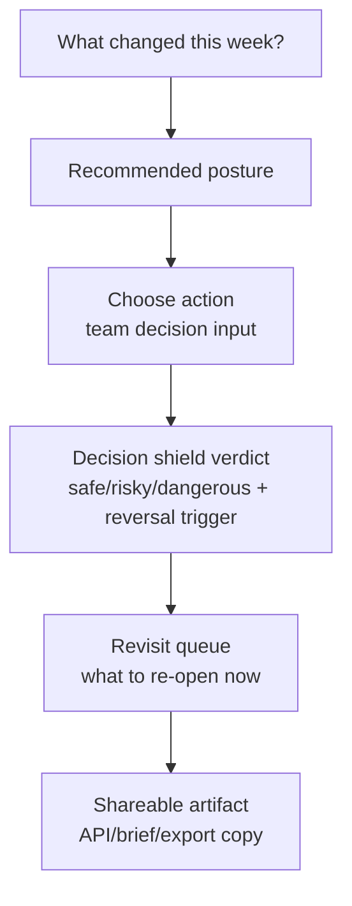
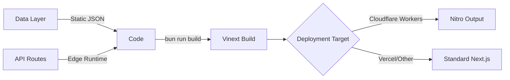

# Architecture Documentation (Improved)

> **Status**: This document explains, in practical terms, how Whether turns public macro signals into a weekly operating brief. It complements `architecture.md` with clearer diagrams, module boundaries, and a more direct description of what each part of the system is doing.

---

## What This System Does in Plain English

Whether is not a generic macro dashboard.

It pulls in a small set of public market and macro signals, decides what kind of operating environment those signals imply, translates that into practical guidance, and packages the result into a brief that a founder or product leader can read quickly and share with a team.

In simple terms, the product tries to answer four questions:

- What changed this week?
- What kind of environment are we in?
- What should we tighten, loosen, or revisit?
- What can we share in a meeting or Slack without rewriting it from scratch?

The architecture is built around that flow:

**signals → posture → decisions → shareable artifact**

---

## System Overview

Whether turns public macro signals into a weekly operating read for startup and product leaders.

The system is not mainly trying to teach macroeconomics. It is trying to help an operator make a faster call about what to do next.

At a high level, the product works like this:

1. Collect market and macro signals.
2. Turn those signals into a simple read on the current environment.
3. Map that environment to operating guidance.
4. Render the result as a brief, decision card, answer page, or export.

The architecture is optimized for **decision transmission**: turning noisy inputs into a recommendation that can be scanned quickly, acted on, and shared with other people.

---

## High-Level Architecture Diagram

This diagram shows the core path through the system. Data comes in, the core logic interprets the environment, report builders shape that interpretation into something presentable, and the app turns it into pages and exports.

```mermaid
graph TB
    subgraph "Data Ingestion Layer"
        A1[Treasury API] -->|Yields + Data| A2[treasuryClient.ts]
        A3[Macro Sources] -->|Signals| A4[snapshot.ts]
        A2 --> A5[treasuryNormalizer.ts]
        A4 --> A5
        A5 --> A6[sensors.ts]
    end
    
    subgraph "Core Logic Layer"
        A6 --> B1[regimeEngine.ts]
        B1 -->|Regime Assessment| B2[playbook.ts]
        B2 -->|Operating Levers| B3[boundedDecisionRules.ts]
        B1 -->|Diagnostics| B4[homeBriefModel.ts]
    end
    
    subgraph "Report Assembly Layer"
        B3 --> C1[homePageAssembler.ts]
        B4 --> C1
        B1 --> C2[reportData.ts]
        C2 --> C3[summary/* builders]
        C3 --> C4[weekly/monthly/quarterly/yearly]
    end
    
    subgraph "App Layer"
        C1 --> D1[/app/page.tsx]
        C2 --> D2[/signals]
        C3 --> D3[/decide/[slug]]
        C4 --> D4[/api/* endpoints]
    end
    
    subgraph "Artifact Layer"
        D1 --> E1[Weekly Brief UI]
        D2 --> E2[Signals Explorer]
        D3 --> E3[Decision Answer Pages]
        D4 --> E4[API Exports]
        E1 --> E5[Slack Brief Export]
        E2 --> E5
        E3 --> E5
        E4 --> E5
    end
    
    style B1 fill:#e1f5ff
    style B2 fill:#e1f5ff
    style C1 fill:#fff4e6
    style D1 fill:#fff4e6
```

---

## Data Flow: Signals → Posture → Decision → Artifact

This is the product's main loop in plain English: gather signals, classify the moment, map that to action, and hand the user something usable.



---

## Regime Classification Logic

This is the central compression step in the system. Instead of asking the user to interpret raw macro data directly, Whether converts that data into a smaller set of operating environments.



### Regime Definitions

| Regime | Tightness | Risk Appetite | Plain-English meaning | Default posture |
|--------|-----------|---------------|-----------------------|-----------------|
| SCARCITY | > 70 | Any | Capital is expensive and conditions are tight | Tighten aggressively |
| DEFENSIVE | 50-70 | < 50 | Conditions are not broken, but they do not justify relaxed bets | Preserve capital and be selective |
| VOLATILE | Any | High variance | Signals are moving around enough that confidence should stay lower | Monitor closely and avoid overcommitting |
| EXPANSION | < 50 | > 50 | Conditions support more forward movement and investment | Loosen selectively and invest |

---

## Core Module Breakdown

These modules form the core reasoning path of the product. They matter more than the UI because this is where raw signals become posture, guidance, and final output.

### `lib/regimeEngine.ts`

The core classification engine. It takes normalized market inputs and decides what kind of environment the operator is in.

**Key Functions:**
- `evaluateRegime()` - Main scoring function
- `computeTightnessScore()` - Base rate + curve slope → tightness
- `computeRiskAppetiteScore()` - Curve slope → risk appetite
- `applyMacroAdjustments()` - Apply macro signal adjustments

**Outputs:**
```typescript
{
  regime: "SCARCITY" | "DEFENSIVE" | "VOLATILE" | "EXPANSION";
  thresholds: { tightnessRegime: number; riskAppetiteRegime: number };
  scores: { tightness: number; riskAppetite: number; baseRate?: number; curveSlope?: number | null };
}
```

### `lib/playbook.ts`

Maps each regime to practical operating guidance. This is the layer that turns environmental assessment into advice about how to behave.

**Key Functions:**
- `buildPlaybookGuidance()` - Get stop/start/fence guidance for a regime
- `buildCanonicalBoundedDecisionRules()` - Create threshold-based rules

**Operating Levers:**
```typescript
type OperatingLeverKey = 
  | "burn-discipline"
  | "capital-raising"
  | "expansion-bets"
  | "hiring"
  | "product-tempo";
```

### `lib/report/homeBriefModel.ts`

Builds the main homepage brief model. It combines the regime call, operating guidance, and recent context into a structure the UI can render cleanly.

**Key Functions:**
- `buildHomeBriefModel()` - Core assembly function
- `buildWeeklyDecisionCardViewModel()` - UI view model builder

### `lib/report/homePageAssembler.ts`

Composes the full homepage. It coordinates data loading, model assembly, and section-level output so the weekly brief arrives as one coherent page.

**Key Functions:**
- `assembleHomePage()` - Full page assembly
- `buildCommandBarPayload()` - Command center data

---

## App Layer Structure

The app layer mostly exists to deliver the outputs of the reasoning system in a few forms: the homepage brief, answer pages, operations workflows, and supporting reference pages.

```
app/
├── page.tsx                          # Homepage (weekly brief)
├── [legacySlug]/                     # Legacy route handling
├── about/                            # About pages
├── answers/[slug]/                   # Short-form answer pages
├── decide/[slug]/                    # Decision answer pages
│   ├── clusterRoutes.ts              # Cluster-based routing
│   └── decisionAnswerPageContent.tsx # Answer page content
├── concepts/[slug]/                  # Concept explainer pages
├── learn/failure-modes/[slug]        # Failure mode learning
├── guides/                           # Stage/stakeholder guides
├── operations/                       # Operations workflow
│   └── components/
│       ├── decisionShieldPanel.tsx   # Decision validation UI
│       ├── exportBriefPanel.tsx      # Export functionality
│       └── operationsWorkflowProgress.tsx
├── signals/                          # Signal monitoring
├── sources/                          # Data source info
├── formulas/                         # Methodology docs
├── mockups/                          # UI testing pages
└── components/                       # Shared React components
    ├── home/                         # Homepage sections
    │   ├── homeBriefSections.tsx     # Main brief sections
    │   └── weeklyDiagnosticsFallback.tsx
    ├── weekly-card/                  # Decision card UI
    │   ├── presentationAdapter.ts    # View model adapter
    │   └── HistorySection.tsx        # Historical context
    ├── report-shell/                 # Page shell layout
    │   ├── types.ts                  # Shell type definitions
    │   └── TrustBlocks.tsx           # Trust indicators
    └── ui/                           # Reusable UI primitives
```

---

## API Layer

The API layer exposes the same core reasoning in machine-readable form. That makes the product usable beyond the UI, including exports, integrations, and alternate cadences.

### Summary APIs (`/api/*`)

| Endpoint | Method | Purpose |
|----------|--------|---------|
| `/api/weekly` | GET | Weekly summary copy + structured fields |
| `/api/monthly` | GET | Monthly summary with structured output |
| `/api/quarterly` | GET | Quarterly summary payload |
| `/api/yearly` | GET | Yearly summary payload |
| `/api/summary-delta` | GET | Structured diff between cadences |

### Decision & Alert APIs

| Endpoint | Method | Purpose |
|----------|--------|---------|
| `/api/regime-alerts` | GET, POST | Read/create regime alert events |
| `/api/decision-memory` | GET, POST | List/create decision memory entries |
| `/api/alert-preferences` | GET, POST | Manage delivery preferences |
| `/api/decision-events` | GET | Retrieve regime transition events |

### Integration APIs

| Endpoint | Method | Purpose |
|----------|--------|---------|
| `/api/integrations/weekly-mandate` | GET | Destination-specific weekly mandate payload |
| `/api/billing/checkout` | POST | Create Stripe Checkout sessions |
| `/api/billing/webhook` | POST | Stripe webhook receiver |

---

## Data Layer

The data layer is mostly structured files and caches rather than a heavy real-time pipeline. That fits the product: the goal is a trustworthy operating read, not tick-by-tick market monitoring.

### Primary Data Files (`/data/`)

| File | Purpose |
|------|---------|
| `macro_snapshot.json` | Current macro indicators with sources |
| `weekly_summaries_2018_2026.json` | Historical weekly briefs |
| `monthly_summaries_2012_2025.json` | Monthly summaries |
| `summary_archive.json` | Archive data for historical queries |
| `recommendations.ts` | Playbook insight database |

### Cache Files

| File | Purpose |
|------|---------|
| `time_machine_cache.json` | Accelerates historical queries |
| `summary_monthly_regime_history.json` | Monthly regime history for forecasts |

---

## Summary Structure Pipeline

This pipeline shows how raw inputs and archived history are turned into structured summaries and then into final copy and API payloads.



---

## Decision Transmission Path (Operator View)

This is the user-facing version of the system. The product is trying to move someone from "what changed?" to "what should we do?" to "what can we share?"



---

## Loop Stage Module Boundaries

This section is important because it draws hard lines between data prep, decision logic, and presentation. The point is to keep scoring and policy out of UI code and keep rendering concerns out of the reasoning layer.

### 1) Signals (normalize and readiness)

**Owner modules:**
- `lib/report/reportData.ts`
- `lib/report/homePageData.ts`
- `lib/report/signalFormatting.ts`

**Tagged functions:**
- `loadReportData` / `loadHomePageReportData` - signal fetch + normalization
- `buildReportDynamics` - weekly signal deltas
- `normalizeSignalContributions` - signal contribution normalization

**Allowed dependencies:**
- data clients (`lib/treasury/*`, `lib/snapshot.ts`, `lib/sensors.ts`)
- formatting/utilities

**What this layer should do:**
- fetch, clean, and normalize signals
- prepare data for downstream scoring

**Must not depend on:**
- React components
- route/page rendering modules

### 2) Posture + decision derivation

**Owner modules:**
- `lib/report/homeBriefModel.ts`
- `lib/report/decisionKnobs.ts`
- `lib/report/operatingCalls.ts`
- `lib/playbook.ts`

**Tagged functions:**
- `buildHomeBriefModel` - core home model assembly
- `buildWeeklyDecisionCardViewModel` - UI view model builder
- `buildFlipRiskMeterState` - flip risk assessment
- `deriveDecisionKnobs` - operating lever derivation

**Allowed dependencies:**
- normalized report models/signals
- deterministic decision libraries (`boundedDecisionRules`, `regimeEngine`, `thresholds`)

**What this layer should do:**
- decide what environment the user is in
- derive posture, decision knobs, and operating calls
- produce stable view models for the presentation layer

**Must not depend on:**
- React UI modules

### 3) Presentation + artifact transmission

**Owner modules:**
- `app/components/weeklyDecisionCard.tsx`
- homepage sections under `app/components/home/*`
- export components under `app/operations/components/*`

**Tagged functions/components:**
- `WeeklyDecisionCard` - decision card component
- `HomeWhatChangedSection`, `HomeDecisionSection`, `HomeRevisitFlipSection` - main brief sections

**Allowed dependencies:**
- stage-2 view models and artifacts
- display formatting/trust helpers

**What this layer should do:**
- render the brief, decision card, and export surfaces
- make the output easy to scan and share

**Must not do:**
- threshold scoring
- regime/decision policy derivation

---

## Extension Points

These are the safest places to extend the system without blurring the architectural boundaries above.

### Adding New Sensors

1. Add normalized source in `lib/treasury/*` or `lib/macroSnapshot.ts`
2. Wire it into `lib/sensors.ts`
3. Update `lib/regimeEngineCore.ts` to use the new sensor

### Adding New Guidance

1. Update `data/recommendations.ts` with insight entries
2. Extend `lib/playbook.ts` mappings
3. Add bounded decision rules in `lib/report/boundedDecisionRules.ts`

### Adding New Report Lanes

1. Add route under `app/`
2. Create corresponding builders in `lib/report/*`
3. Wire into `homePageAssembler.ts`

---

## Caches and Snapshots

| File | Purpose |
|------|---------|
| `data/snapshot_fallback.json` | Offline baseline for latest Treasury reading |
| `data/macro_snapshot.json` | Expanded macro signals with explicit sources |
| `data/time_machine_cache.json` | Accelerates historical queries |
| `data/summary_archive.json` | Full history for advanced views |

---

## Client Provider Placement

- **Global (`app/layout.tsx`)**: Server-first, shell concerns only (metadata, skip link, shared header)
- **Scoped providers**:
  - `app/signals/layout.tsx`: ToastProviderRoot for time machine summaries
  - `app/operations/layout.tsx`: ToastProviderRoot + PremiumFunnelTracker

---

## Testing Strategy

### Unit Tests
- `lib/regimeEngine.test.ts` - Regime scoring logic
- `tests/summaryArchiveMigration.test.ts` - Archive migration validation

### Integration Tests
- Playwright snapshots in `output/playwright/`
- UI capture scripts in `scripts/ui-capture.mjs`

---

## Deployment Architecture



---

## Performance Considerations

Performance choices are tuned for a decision brief, not a live trading terminal.

- **Revalidation**: `revalidate = 900` (15 minutes) on homepage
- **Runtime**: Edge runtime for API routes and homepage
- **Streaming**: Suspense-based streaming with fallbacks
- **Caching**: Snapshot fallback + time machine cache for historical queries

---

## Migration Status: Next.js → vinext

| Component | Status |
|-----------|--------|
| Build system | ✅ vinext configured |
| Cloudflare Workers | ✅ Supported via Nitro |
| Dev server | ✅ `bun run dev:vinext` |
| Production build | ✅ `bun run build:cloudflare` |

---

## Key Formulas

### Tightness Score
```
tightness = f(baseRate, curveSlope, thresholds)
```

### Risk Appetite Score
```
riskAppetite = g(curveSlope, thresholds)
```

### Regime Classification
```
if tightness > 70: SCARCITY
else if riskAppetite < 50 and tightness > 50: DEFENSIVE
else if volatility high: VOLATILE
else: EXPANSION
```

---

## Troubleshooting

### Common Issues

1. **Regime not updating**: Check `data/macro_snapshot.json` freshness
2. **Historical data missing or stale**: Run `bun run time-machine:update-summaries --start-year <year> --end-year <year>` to backfill archive/cache history, then `bun run data:refresh-fallbacks` to refresh latest fallback snapshots.
3. **Build failures**: Ensure vinext is properly installed via `bun install`

---

## Plain-English Summary

Whether takes public macro and market signals, turns them into a simple operating read, maps that read to concrete guidance, and packages the result into something a team can actually use.

The architecture is strongest when read as a decision system, not just a data system:

- the data layer gathers and normalizes inputs
- the core logic decides what kind of moment this is
- the playbook and report builders translate that into action
- the app and APIs turn it into a brief, answer page, or export

Put simply: the product takes market signals, decides what kind of environment they imply, and tells operators how to act.

---

## Related Documentation

- [`architecture.md`](./architecture.md) - Original architecture overview
- [`loop-stage-module-boundaries.md`](./loop-stage-module-boundaries.md) - Module ownership and boundaries
- [`one-screen-weekly-brief-spec.md`](./one-screen-weekly-brief-spec.md) - Weekly brief contract
- [`developer/api-reference.md`](./developer/api-reference.md) - API endpoint contracts
