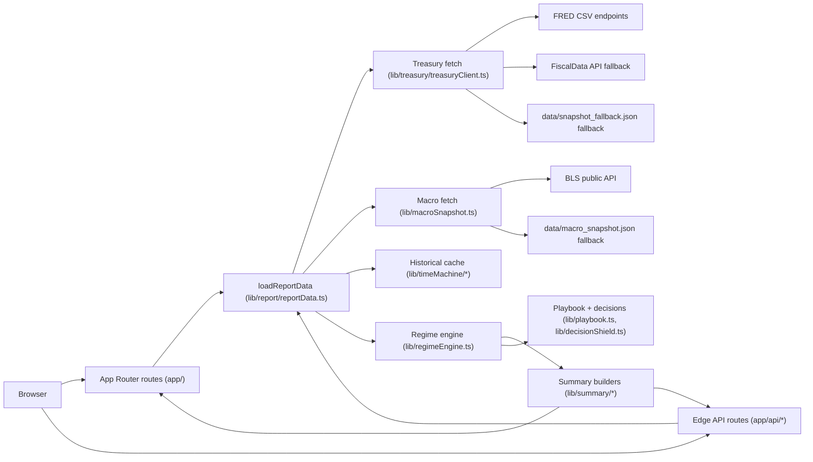
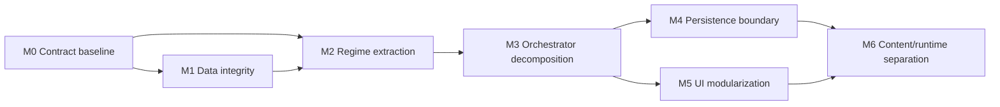

# Architecture Overview (Current State)

This document reflects the codebase as implemented on **March 4, 2026**. It is an implementation map, not a target-state design.

## 1) System Snapshot

- Framework: **Next.js 16 App Router** (`app/`) on React 19.
- Runtime mix: mostly server components + edge route handlers.
- Package manager: **Bun**.
- Deployment target: Vercel build output adapted for **Cloudflare Pages/Workers** (`next-on-pages` path in `scripts/build.mjs`).
- Source inventory:
  - `app/`: 173 files, including 70 `page.tsx` routes and 13 API route handlers.
  - `lib/`: 75 files (domain logic + shared utilities).
  - `scripts/`: 18 files (build, summary generation, CI tooling).
  - `tests/`: 49 test files (`node --test` + `tsx`).

## 2) Runtime Topology

## 3) Route and Surface Map

### Primary report surfaces

- `/` (weekly operating brief): orchestrates regime + action framing via `loadReportDataWithTimeout`.
- `/signals` and `/evidence` (alias): diagnostics, thresholds, historical replay, regime timeline.
- `/operations`: playbook-oriented action panels and export utilities.
- `/briefing`: one-screen weekly leadership summary model.

### Supporting product surfaces

- `/start`, `/decide/*`, `/posture/*`, `/toolkits/*`, `/reference`, `/resources/*`, `/concepts/*`, `/solutions/*`, `/answers/*`, `/startup-macro-posture/*`.
- Many of these are content-heavy pages driven by large typed content modules rather than live data.

### Agent/discovery surfaces

- `/api/agent`
- `/llms.txt`
- `/.well-known/whether-agent.json`
- MCP server wrapper in `scripts/mcp/whether-mcp-server.ts` exposes cadence summaries and skill metadata over stdio.

## 4) Request Lifecycle (Core Flow)

`lib/report/reportData.ts` is the orchestration entrypoint, now decomposed into service modules under `lib/report/services/*`.

1. Parse URL controls:
   - historical selection (`month`, `year`) via `lib/timeMachine/timeMachineSelection.ts`
   - threshold overrides via `lib/thresholds.ts`
2. Fetch inputs in parallel:
   - `InputLoader`: treasury + macro loading + cache/selection context (`lib/report/services/inputLoader.ts`)
3. Build derived signals:
   - `RegimeAssembler`: sensor readings + regime assessment + comparisons (`lib/report/services/regimeAssembler.ts`)
4. Build decision framing:
   - `GuidanceAssembler`: playbook start/stop/fence + status labels (`lib/report/services/guidanceAssembler.ts`)
   - `Dynamics` helpers: trend and signal-change projections (`lib/report/services/dynamics.ts`)
5. Build provenance/status labels used in both UI and APIs.
   - `ProvenanceBuilder`: treasury/macro/internal provenance shaping (`lib/report/services/provenanceBuilder.ts`)
6. Return one large aggregate payload consumed by page routes and route handlers.
   - `ViewModelAssembler`: final contract assembly (`lib/report/services/viewModelAssembler.ts`)

### Important runtime behavior

- `loadReportData()` memoizes a default in-process promise when called without search params.
- `loadReportDataWithTimeout()` falls back to snapshot-based data if orchestration exceeds timeout.
- Historical mode disables macro adjustments in some paths and runs off time-machine snapshots.

## 5) Domain Module Boundaries

### A. Data ingestion and normalization

- `lib/treasury/treasuryClient.ts`
  - Primary source: FRED CSV series (`DGS1MO`, `DGS3MO`, `DGS2`, `DGS10`)
  - Secondary source fallback: FiscalData Treasury API
  - Final fallback: checked-in snapshot
- `lib/macroSnapshot.ts`
  - Live fetch for CPI, unemployment, spreads, FCI, VIX
  - Falls back to checked-in macro snapshot payload
- Shared transport behavior: `lib/fetchWithTimeout.ts`.

### B. Regime and policy evaluation

- `lib/regimeEngine.ts` (public facade):
  - Preserves legacy import path and exports.
  - Delegates to extracted modules under `lib/regimeEngine/*`.
- `lib/regimeEngine/scoring.ts`:
  - Computes base-rate and curve-slope derived scores.
  - Applies macro adjustments to tightness/risk appetite.
  - Classifies regime (`SCARCITY | DEFENSIVE | VOLATILE | EXPANSION`).
- `lib/regimeEngine/diagnostics.ts` + `lib/regimeEngine/transitions.ts`:
  - Computes diagnostics and regime trend/reasoning helpers.
- `lib/regimeEngine/policy.ts`:
  - Computes policy composites, posture, confidence index, and refusal state.
- `lib/regimeEngine/evaluate.ts`:
  - Assembles final `RegimeAssessment` payload from extracted modules.
- `lib/policy/*`:
  - `config.ts`: normalization spec and thresholds.
  - `transforms.ts`: z-score/directional transforms/composites.
  - `governance.ts`: governance parameter mapping by posture.

### C. Summary and report outputs

- `lib/summary/*`: weekly/monthly/quarterly/yearly structured summaries, copy renderers, deltas, hashing, archive parsing.
- `lib/report/*`: route-facing composition logic, trust labels, narrative helpers, weekly leadership model.
- `lib/export/*` + `lib/exportNotices.ts`: Slack/board/constraint export text.

### D. Decision utilities

- `lib/decisionShield.ts` + `lib/decisionShieldConfig.ts`: deterministic verdict matrix + guardrails.
- `lib/whetherToShipChecklist.ts`, `lib/personalizedMandates.ts`: lightweight decision tools used in `/decide/*`.

### E. Navigation/content systems

- Navigation and route helpers in `lib/navigation/*`.
- Large static content registries:
  - `lib/informationArchitecture.ts`
  - `lib/productCanon.ts`
  - `lib/resourcesContent.ts`
  - `lib/resourceArticles.ts`
  - `app/answers/decisionPages.ts`
  - `app/startup-macro-posture/clusterData.ts`

## 6) API Architecture

All API handlers are in `app/api/*` and mostly `runtime = "edge"`.

| Route | Role | Core dependencies |
| --- | --- | --- |
| `/api/weekly` | Weekly summary + agent handoff + hash | `loadReportData`, `buildWeeklySummary`, `agentHandoff` |
| `/api/monthly` | Monthly summary + agent handoff + hash | `loadReportData`, `buildMonthlySummary`, `agentHandoff` |
| `/api/quarterly` | Quarterly summary | `loadReportData`, `buildQuarterlySummary` |
| `/api/yearly` | Yearly summary | `loadReportData`, `buildYearlySummary` |
| `/api/cadence` | Weekly vs monthly alignment status | `buildCadenceAlignment` |
| `/api/summary-delta` | Weekly/monthly constraint deltas | `buildSummaryDelta` |
| `/api/treasury` | Raw treasury payload | `fetchTreasuryData` |
| `/api/health` | service + data freshness health check | `loadReportData` |
| `/api/agent` | cadence-specific agent payload | `buildAgentInterfaceResponse` |
| `/api/integrations/weekly-mandate` | Slack/Notion/Linear payload rendering | `buildWeeklyMandatePayload` |
| `/api/regime-alerts` | alert store read/write via persistence adapter | `serverStore`, `signalOps` |
| `/api/weekly-digest` | digest from stored alert history | `serverStore`, `signalOps` |
| `/api/og` | dynamic SVG OG image generation | `fetchTreasuryData`, `evaluateRegime` |

## 7) State and Persistence Model

### Server-side state

- `lib/serverStore.ts` now provides a pluggable persistence boundary for:
  - `regimeAlerts`
  - `alertDeliveries`
  - `decisionMemory`
- Adapter behavior:
  - default: file-backed adapter when Node file APIs are available (path from `WHETHER_SERVER_STORE_FILE`, default `/tmp/whether-server-store.json`)
  - fallback: in-memory adapter when file persistence is unavailable or explicitly selected via `WHETHER_SERVER_STORE_BACKEND=memory`
- Route behavior for `/api/regime-alerts` and `/api/weekly-digest` is unchanged at the contract level; durability now depends on adapter selection/runtime capabilities.

### Client-side state

- Multiple feature-specific local/session storage keys are used (`whether-theme`, `whether-display-mode`, `whether.lastReadSnapshot`, `whether.regimeAlerts`, decision-shield and assumptions keys, command-center keys).
- Query params are used as a state channel for thresholds, time machine selection, decision-shield selections, and assumption locks.

## 8) Data Artifacts and Offline Inputs

| File | Purpose | Current observed state (2026-03-04) |
| --- | --- | --- |
| `data/snapshot_fallback.json` | emergency treasury fallback | single latest fallback object |
| `data/macro_snapshot.json` | macro signal fallback source | 12 series |
| `data/time_machine_cache.json` | historical treasury snapshots | 99 monthly snapshots (`2018-01-31` to `2026-03-03`) |
| `data/weekly_summaries_2018_2026.json` | generated weekly summary history | 426 entries |
| `data/monthly_summaries_2012_2025.json` | generated monthly summary history | 170 entries |
| `data/summary_archive.json` | merged multi-cadence summary archive | 676 entries (426 weekly, 170 monthly, 64 quarterly, 16 yearly) |

## 9) Build, Deploy, and Generation Pipelines

### Runtime build/deploy

- `scripts/build.mjs` switches between:
  - standard `next build --webpack`
  - `next-on-pages` flow for Cloudflare target
- `scripts/cloudflare-build-and-upload.mjs` reuses cached build output when commit SHA matches, then uploads worker versions with Wrangler.

### Historical summary generation

- `scripts/generateWeeklySummaries.ts`
- `scripts/generateMonthlySummaries.ts`
- `scripts/generateQuarterlyYearlySummaries.ts`
- `scripts/updateTimeMachineSummariesSince.mjs` orchestrates all three with year-range env controls.
- Archive writes happen through `scripts/summaryArchive.ts`.

## 10) Test Architecture

- Test runner: Node built-in test runner (`node --test`) via `scripts/run-tests.mjs`.
- Coverage emphasis:
  - domain logic (`regimeEngine`, treasury client, summary builders, policy transforms)
  - route contract tests (summary APIs, integration endpoint validation)
  - utility behavior and data quality checks
- Current gap: no browser E2E/system tests for key user flows.

## 11) Coupling and Hotspots (Refactor-Relevant)

1. **Central contract concentration**
   - `lib/report/reportData.ts` remains a high fan-in entrypoint used by many pages and APIs.
   - Core logic is now split into service modules (`inputLoader`, `regimeAssembler`, `guidanceAssembler`, `provenanceBuilder`, `viewModelAssembler`), but output-contract coupling remains high.

2. **Large UI monoliths**
   - `app/components/appendixSections.tsx` (~2.6k LOC), `app/components/reportShell.tsx` (~734 LOC), `app/signals/page.tsx` (~652 LOC).
   - High coupling between UI composition and domain transforms increases refactor blast radius.

3. **Inactive or partially integrated UI features**
   - Several client components exist but are not currently mounted by active routes (`DecisionShieldPanel`, `DecisionMemoryPanel`, `AssumptionLockPanel`, `ExecutiveBriefingPanel`, `StrategyBriefPanel`, `RegimeAlertsPanel`, etc.).
   - Some of these depend on API routes not present in `app/api/*` (`/api/decision-memory`, `/api/alert-deliveries`, `/api/alert-preferences`).

4. **Archive contract protection relies on CI guardrails**
   - `lib/summary/summaryArchive.ts` performs strict zod validation over the full archive.
   - Archive validation is now enforced with `scripts/validate-summary-archive.mjs` in CI; bypassing this guard reintroduces parse-failure risk.

5. **Historical replay freshness requires active maintenance**
   - Time-machine coverage now spans 99 monthly snapshots, with freshness/backfill validation via `scripts/validate-time-machine-cache.mjs`.
   - If cache backfill is not run regularly, historical mode quality can degrade silently.

6. **State durability variability**
   - Signal ops state now uses an adapter boundary with file-backed durability where available.
   - Environments without file persistence still fall back to in-memory behavior.

7. **Content and app logic co-location**
   - Product content system and runtime decision system are tightly co-located in `app/` and `lib/`, making targeted refactors harder.

## 12) Refactor Seams to Preserve

For a major refactor, these seams are good candidates:

- `Data acquisition boundary`: treasury + macro fetch + fallback contracts.
- `Regime core boundary`: scoring/classification/policy pure domain package.
- `Report composition boundary`: `loadReportData` decomposition into smaller composable services.
- `Summary contract boundary`: stable typed API contracts (`weekly/monthly/...`) decoupled from rendering copy.
- `State boundary`: explicit persistence adapter replacing process-memory store.
- `Content boundary`: isolate static content registries from runtime scoring stack.

These boundaries map closely to current hotspots and can reduce blast radius while preserving current external behavior.

## 13) Phased Refactor Plan (Bounded Milestones)

Planning assumptions:

- Schedule uses 1-week and 2-week milestones to keep review and rollback manageable.
- Product delivery continues during the refactor (no long-lived freeze branch).
- Each milestone must meet its exit gate before the next dependent milestone starts.

### Milestone plan

| Milestone | Duration | Objective | Scope (in) | Scope (out) | Exit gate | Depends on | Status |
| --- | --- | --- | --- | --- | --- | --- | --- |
| M0: Contract baseline and safety rails | 1 week | Freeze current external contracts and establish regression visibility. | Add/expand contract tests for `/api/weekly`, `/api/monthly`, `/api/cadence`, `/api/summary-delta`; create golden snapshots for key `loadReportData` outputs; add architecture decision record (ADR) for target module boundaries. | UI redesign or route reorganization. | CI passes with new contract tests; baseline outputs committed and documented. | None | Complete (2026-03-04) |
| M1: Data integrity hardening | 1 week | Remove known data-path fragility before structural moves. | Migrate `data/summary_archive.json` to valid schema, add archive validator script in CI, define time-machine cache freshness/backfill rule and regenerate minimum viable history set. | Rewriting summary builder semantics. | `getSummaryArchive()` loads non-empty valid records; time-machine checks pass with explicit freshness threshold. | M0 | Complete (2026-03-04) |
| M2: Regime core extraction | 2 weeks | Isolate regime/policy logic into pure domain modules with stable interfaces. | Split `lib/regimeEngine.ts` into focused modules (scoring, classification, diagnostics, policy overlays); keep adapters for legacy call sites; add parity tests for regime outputs. | Changing regime formulas or product thresholds. | Parity test suite passes; old and new paths return identical outputs for fixture set. | M0, M1 | Complete (2026-03-04) |
| M3: Report orchestrator decomposition | 2 weeks | Break `loadReportData` into composable services. | Introduce explicit services: `InputLoader`, `RegimeAssembler`, `GuidanceAssembler`, `ProvenanceBuilder`, `ViewModelAssembler`; move provenance shaping to dedicated unit; reduce route coupling to orchestration internals. | New user-facing features. | `loadReportData` becomes thin composition layer; all report/API routes pass contract tests unchanged. | M2 | Complete (2026-03-04) |
| M4: Persistence boundary and signal ops durability | 1 week | Replace process-memory assumptions with pluggable persistence contracts. | Create storage adapter interface for alerts/deliveries/decision memory; implement default durable adapter (plus in-memory fallback for local dev); wire `/api/regime-alerts` and `/api/weekly-digest` to adapter. | Notification channel expansion. | Restart-safe persistence verified in integration tests; API behavior unchanged at contract level. | M3 | Complete (2026-03-04) |
| M5: UI and route-level modularization | 2 weeks | Reduce blast radius in monolithic UI files and align dead/inactive surfaces. | Split `appendixSections`/`reportShell` into smaller domain-scoped components; create route-level data-view model boundaries; remove or explicitly park inactive panels behind feature flags. | Visual redesign and copy refresh. | Largest UI files reduced to agreed size budget; routes maintain parity screenshots and interaction checks. | M3 | Pending |
| M6: Content/runtime separation and cleanup | 1 week | Decouple static content systems from runtime decision engine and finalize migration. | Move large static registries behind a dedicated content boundary (`content/` or `lib/content/*`); remove deprecated shims; update docs (`docs/architecture.md`, `docs/feature-specs-current.md`, `docs/implementation-status.md`). | New content taxonomy project. | No runtime imports from deprecated paths; docs and ownership map updated; final refactor checklist closed. | M4, M5 | Pending |

### Dependency order and critical path

Critical path (minimum elapsed time): **M0 -> M1 -> M2 -> M3 -> M4 -> M6** (8 weeks).  
UI modularization (`M5`) can run in parallel with `M4` after `M3`, keeping total plan at ~9 weeks including buffer.

### Milestone-level verification matrix

| Milestone | Required validation |
| --- | --- |
| M0 | `bun run lint`, `bun run test`, route contract tests for summary APIs |
| M1 | Archive validator script, time-machine cache integrity test, targeted summary archive tests |
| M2 | Regime parity fixtures, policy transform tests, threshold override regression tests |
| M3 | Full summary API suite, `loadReportData` fixture parity, health endpoint checks |
| M4 | Persistence adapter integration tests, alert/digest API regression tests |
| M5 | Component-level tests, route smoke tests, parity screenshots for `/`, `/signals`, `/operations` |
| M6 | `bun run check`, docs-link verification, dead-code/import path checks |

### Risks and controls by phase

| Risk | Most exposed milestones | Control |
| --- | --- | --- |
| Silent contract drift on summaries | M2, M3 | Golden fixtures + API contract tests gated in CI |
| Data quality regressions from archive/cache cleanup | M1 | Pre-merge validator + regenerate scripts + freshness checks |
| Runtime instability from persistence changes | M4 | Adapter abstraction, dual-write cutover window, rollback to in-memory adapter |
| UI regressions during decomposition | M5 | Screenshot parity and route smoke checks before merge |
| Scope creep into product redesign | M3, M5 | Explicit out-of-scope list per milestone + PR template gate |
