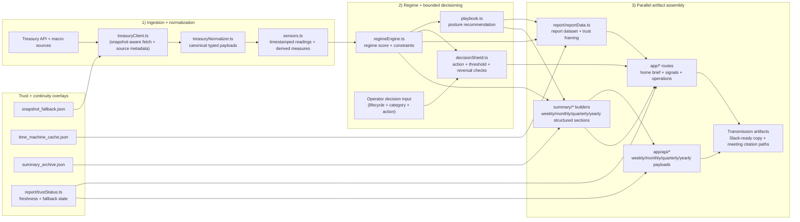
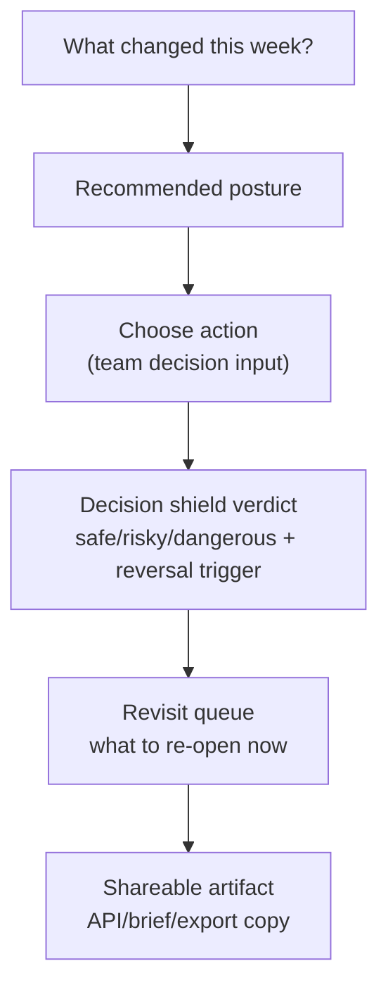

# Architecture overview

> **Note**: For comprehensive diagrams, detailed module breakdowns, and visual data flows, see [`architecture-improved.md`](./architecture-improved.md). This file serves as a concise reference with essential system boundaries.

Whether (Regime Station) is a Next.js App Router product that turns Treasury macro data into
operational guidance. The system is organized around a small number of deterministic pipelines:
fetch/normalize data, score the regime, generate guidance, and render reports.

## One-screen architecture diagram


### Decision transmission path (operator view)


## Runtime data flow
1. **Treasury fetch** via `lib/treasury/treasuryClient.ts`, with snapshot fallback and
   source metadata attached.
2. **Normalization** in `lib/treasury/treasuryNormalizer.ts` to map API payloads into
   typed, consistent shapes.
3. **Sensor construction** in `lib/sensors.ts` (yield curve slope, base rate, macro snapshots)
   to produce source+timestamp annotated readings.
4. **Regime scoring** in `lib/regimeEngine.ts`, producing the market climate and constraints.
5. **Guidance selection** in `lib/playbook.ts` and **action validation** in
   `lib/decisionShield.ts` for operator decisions.
6. **Report assembly** in `lib/report/reportData.ts` and summary generators in `lib/summary/*`.
7. **UI rendering** through `app/` routes (overview, signals, operations) backed by API
   endpoints under `app/api/*`.

## Core domains and modules
- **Data acquisition**: `lib/treasury/*`, `lib/macroSnapshot.ts`, `lib/snapshot.ts`.
- **Scoring + classification**: `lib/regimeEngine.ts`, `lib/thresholds.ts`.
- **Decision support**: `lib/decisionShield.ts`, `lib/decisionShieldConfig.ts`.
- **Guidance content**: `lib/playbook.ts`, `data/recommendations.ts`.
- **Historical analysis**: `lib/timeMachine/*`, `data/time_machine_cache.json`.
- **Report generation**: `lib/report/*`, `lib/summary/*`.
- **Navigation + UX framing**: `lib/navigation/*`, `lib/operatorRequests.ts`.

## Summary structure pipeline (weekly/monthly)
```mermaid
flowchart TD
  A[Treasury + macro inputs] --> B[Regime assessment
lib/regimeEngine.ts]
  B --> C[Structured summary builders
lib/summary/weeklySummary.ts
lib/summary/monthlySummary.ts]
  C --> D[Copy renderer
(summary.copy derived from structured)]
  C --> E[/api/weekly + /api/monthly
structured + provenance + copy/]
  F[data/summary_archive.json] --> G[parseSummaryArchive
legacy hydration]
  G --> C
```

### Core formulas (deterministic)
- **Constraint continuity check (weekly vs monthly):**

  $$
  \text{unchanged} = W \cap M, \quad
  \text{added} = M \setminus W, \quad
  \text{removed} = W \setminus M
  $$

- **Summary-hash stability input:**

  \[
  H = \operatorname{hash}(\{title, summary, regime, regimeLabel, guidance, constraints, recordDateLabel, provenance\})
  \]

These formulas keep archive hydration, API output, and UI rendering deterministic across current and historical summaries.

## Caches and snapshots
- `data/snapshot_fallback.json` provides an offline baseline for the latest Treasury reading.
- `data/macro_snapshot.json` stores expanded macro signals with explicit sources.
- `data/time_machine_cache.json` and `data/summary_archive.json` accelerate historical queries
  and summary generation.

## API routes
Summary APIs live under `app/api/*` and mirror the time horizon they serve:
- `/api/weekly`, `/api/monthly`, `/api/quarterly`, `/api/yearly`
  - weekly/monthly payloads expose structured sections plus copy/provenance fields for UI and automation reuse
- `/api/summary-delta` for change detection
- `/api/treasury` for direct Treasury-derived data access

Historical summary playback uses `lib/summary/summaryArchive.ts`, which validates archive entries and only falls back to hydration when legacy records are encountered.

Default brief assembly should stay on the smaller derived history paths: `data/summary_memory_rail_weekly.json` + `lib/summary/weeklyPostureHistory.ts` for the homepage memory rail and `data/summary_monthly_regime_history.json` + `lib/summary/monthlyRegimeHistory.ts` for forecast-history regime points. Keep `lib/summary/summaryArchive.ts` as the canonical full-history loader for advanced `/signals` historical views and Time Machine playback, not the default path for homepage or forecast assembly.

Use `bun run summary-archive:migrate-structured` to materialize `structured` blocks into the checked-in archive and keep runtime hydration as fallback-only behavior.

## Prioritized refactor backlog (structured summaries)
1. **P0 — Centralize copy rendering contracts** ✅ Implemented
   - Weekly/monthly copy assembly now routes through shared renderer helpers keyed by structured sections.
   - Implemented in `lib/summary/summaryCopyRenderer.ts` with shared contracts in `lib/summary/summaryTypes.ts`.
   - Goal: remove formatting drift risk between builders and UI/export surfaces.
2. **P1 — Formalize archive migration step** ✅ Implemented
   - Added `scripts/migrateSummaryArchiveStructured.ts` and Bun scripts to materialize `structured` into historical weekly/monthly archive records.
   - Added `tests/summaryArchiveMigration.test.ts` to prevent regressions where archive entries lose `summary.structured`.
   - Goal: keep runtime hydration fallback-only and simplify validation paths.
3. **P1 — Strengthen contract tests at API boundary**
   - Add route-level tests that assert `/api/weekly` and `/api/monthly` include structured/copy/provenance invariants.
   - Goal: catch schema regressions before UI consumers break.
4. **P2 — Normalize section taxonomy across cadences** ✅ Implemented
   - Monthly structured summaries now include posture, bounded next actions, top reversals, execution constraints, and provenance.
   - Goal: make cross-cadence tooling simpler.
5. **P2 — Persist SummaryCard raw-text toggle preference**
   - Store per-cadence toggle state in local storage.
   - Goal: improve repeat-operator UX without changing default structured-first behavior.

## Extension points
- **New sensors**: add a normalized source in `lib/treasury/*` or `lib/macroSnapshot.ts`, then
  wire it into `lib/sensors.ts`.
- **New guidance**: update `data/recommendations.ts` and extend `lib/playbook.ts` mappings.
- **New report lanes**: add a route under `app/` plus corresponding builders in `lib/report/*`.

## Component hierarchy

```
app/
├── layout.tsx                    # Global shell (metadata, skip link, header)
├── page.tsx                      # Homepage (weekly brief)
│   ├── ReportShell               # Page shell wrapper
│   │   ├── reportShellHeader     # Header with regime badge + date
│   │   └── homeBriefSections     # Main brief content
│   │       ├── HomeWhatChangedSection
│   │       ├── HomeDecisionSection
│   │       └── HomeRevisitFlipSection
│   └── weeklyDecisionCard        # Decision card component
│       ├── HistorySection
│       ├── InputInfluenceSection
│       └── YearAgoComparator
├── [legacySlug]/                 # Legacy route handling
├── about/                        # About pages
├── answers/[slug]/               # Short-form answer pages
├── decide/[slug]/                # Decision answer pages
│   ├── clusterRoutes.ts          # Cluster-based routing
│   └── decisionAnswerPageContent.tsx
├── concepts/[slug]/              # Concept explainer pages
├── learn/failure-modes/[slug]    # Failure mode learning
├── guides/                       # Stage/stakeholder guides
├── operations/                   # Operations workflow
│   ├── components/
│   │   ├── decisionShieldPanel.tsx
│   │   ├── exportBriefPanel.tsx
│   │   └── operationsWorkflowProgress.tsx
├── signals/                      # Signal monitoring
├── sources/                      # Data source info
└── mockups/                      # UI testing pages

lib/
├── report/                       # Report generation
│   ├── homeBriefModel.ts         # Home page data model
│   ├── homePageAssembler.ts      # Page composition
│   ├── decisionKnobs.ts          # Operating levers
│   ├── boundedDecisionRules.ts   # Threshold-based rules
│   └── operatingCalls.ts         # Actionable guidance
├── regimeEngine.ts               # Regime classification
├── playbook.ts                   # Regime → operations mapping
└── summary/                      # Summary builders
    ├── weeklySummary.ts
    ├── monthlySummary.ts
    ├── quarterlySummary.ts
    └── yearlySummary.ts
```

## Client provider placement (global vs scoped)
- Keep `app/layout.tsx` server-first and limit it to true shell concerns (document metadata, skip link, and shared header).
- Scope client providers to the smallest route subtree that needs them:
  - `app/signals/layout.tsx` wraps only the signals experience with `ToastProviderRoot` because summary-copy toasts are rendered from the time machine summary cards.
  - `app/operations/layout.tsx` wraps operations routes with `ToastProviderRoot` and `PremiumFunnelTracker` because operations panels emit both toast notifications and premium CTA telemetry attributes.
- Avoid attaching interaction trackers or toast infrastructure to unrelated routes; this reduces client-side work on pages that do not present those interactions.
