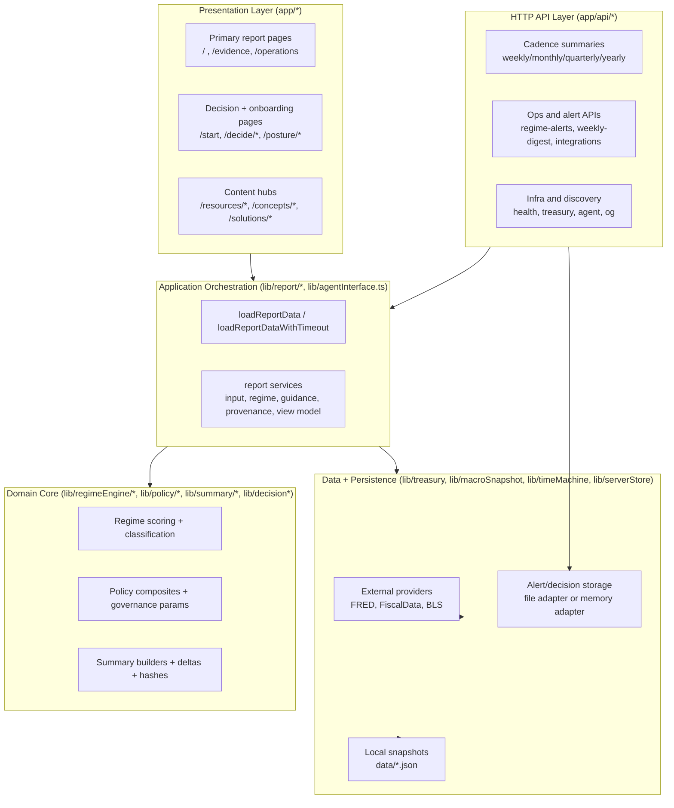

# Architecture Overview (Refactor Baseline)

This document reflects the implementation in the repository as traversed on **March 4, 2026**.
It is the baseline for planning a major architectural refactor.

## 1) System Snapshot

- Framework: **Next.js 16 App Router** + **React 19**.
- Runtime posture: edge-first routes/pages (`runtime = "edge"` in key surfaces).
- Package/runtime toolchain: **Bun** scripts, Node 20.16.x.
- Deploy target: Vercel output adapted for **Cloudflare Pages/Workers** via `next-on-pages` in [`scripts/build.mjs`](../scripts/build.mjs).

Current inventory:

- `app/`: 173 TS/TSX files.
  - `70` page routes (`page.tsx`).
  - `13` API handlers (`app/api/*/route.ts`).
- `lib/`: 89 TypeScript modules.
- `scripts/`: 19 TS/MJS scripts.
- `tests/`: 52 Node test files.

Largest files (refactor pressure hotspots):

1. `app/components/appendixSections.tsx` (2595 LOC)
2. `app/signals/components/timeMachinePanel.tsx` (824 LOC)
3. `lib/informationArchitecture.ts` (756 LOC)
4. `app/components/reportShell.tsx` (734 LOC)
5. `app/operations/components/decisionShieldPanel.tsx` (708 LOC)

## 2) Layered Architecture

## 3) Core Runtime Flows

### A. Weekly report flow (`/`)

Entry:
- [`app/page.tsx`](../app/page.tsx) calls `loadReportDataWithTimeout(...)`.

Orchestration:
- [`lib/report/reportData.ts`](../lib/report/reportData.ts)
  - `loadReportInputs` (treasury + macro + time machine context)
  - `buildRegimeContext` (assessment + trend + comparisons)
  - `buildGuidanceContext` (playbook/start/stop/fence)
  - `buildReportProvenance` (source/freshness labels)
  - `assembleReportViewModel` (contract assembly)

Fallback behavior:
- Timeout race returns snapshot-derived report from `data/snapshot_fallback.json`.
- Default no-param load memoizes in-process promise.

### B. Historical replay flow (`month` + `year` params)

- Selection parsing in [`lib/timeMachine/timeMachineSelection.ts`](../lib/timeMachine/timeMachineSelection.ts).
- Snapshot retrieval in [`lib/timeMachine/timeMachineCache.ts`](../lib/timeMachine/timeMachineCache.ts).
- In historical mode, macro adjustments are intentionally disabled for assessment path (`assessmentMacroSeries = []`).
- Adjacent month navigation is resolved from cache index, not live provider calls.

### C. Alert state flow

- Read/write endpoints:
  - [`app/api/regime-alerts/route.ts`](../app/api/regime-alerts/route.ts)
  - [`app/api/weekly-digest/route.ts`](../app/api/weekly-digest/route.ts)
- Persistence adapter boundary in [`lib/serverStore.ts`](../lib/serverStore.ts):
  - `file` adapter when Node FS APIs are available.
  - `memory` adapter fallback or explicit `WHETHER_SERVER_STORE_BACKEND=memory`.

## 4) Route Architecture

### 4.1 Report and decision surfaces (live data consumers)

`loadReportData*` is used by:

- Pages: `/`, `/signals` (`/evidence` alias), `/operations`, `/start`, `/briefing`, selected `/decide/*`, `/answers/[slug]`, startup posture routes.
- APIs: cadence endpoints, health, integrations.

`loadReportData` currently has **24 importers** across `app/` + `lib/`, making it the main application fan-in point.

### 4.2 API surface map (implemented)

- `/api/agent`
- `/api/weekly`
- `/api/monthly`
- `/api/quarterly`
- `/api/yearly`
- `/api/cadence`
- `/api/summary-delta`
- `/api/treasury`
- `/api/health`
- `/api/integrations/weekly-mandate`
- `/api/regime-alerts`
- `/api/weekly-digest`
- `/api/og`

Discovery endpoints:

- `/llms.txt`
- `/.well-known/whether-agent.json`
- MCP wrapper: [`scripts/mcp/whether-mcp-server.ts`](../scripts/mcp/whether-mcp-server.ts)

### 4.3 Content-heavy route families

Largest page families by count:

- `resources/*` (13 pages)
- `solutions/*` (6 pages)
- `decide/*` (5 pages)
- `concepts/*` (5 pages)

These are primarily static content layers backed by large registries in `lib/informationArchitecture.ts`, `lib/productCanon.ts`, `lib/resourcesContent.ts`, and `lib/resourceArticles.ts`.

## 5) Domain Modules and Boundaries

### 5.1 Data acquisition boundary

Treasury:
- [`lib/treasury/treasuryClient.ts`](../lib/treasury/treasuryClient.ts)
  - Primary: FRED CSV (`DGS1MO`, `DGS3MO`, `DGS2`, `DGS10`)
  - Secondary fallback: FiscalData Treasury API
  - Final fallback: `data/snapshot_fallback.json`

Macro:
- [`lib/macroSnapshot.ts`](../lib/macroSnapshot.ts)
  - Live fetch from BLS/FRED for core series
  - Fallback: `data/macro_snapshot.json`

Transport utility:
- [`lib/fetchWithTimeout.ts`](../lib/fetchWithTimeout.ts)

### 5.2 Regime core boundary

Public facade:
- [`lib/regimeEngine.ts`](../lib/regimeEngine.ts)

Core modules:
- `scoring.ts`: base-rate/slope scoring + macro adjustments + classification
- `evaluate.ts`: composition of scoring + diagnostics + policy assessment
- `policy.ts`: policy composites, refusal logic, governance parameter output
- `transitions.ts`: trend and change reasons
- `types.ts`: canonical regime/policy contracts

The regime engine is imported by **54 files**, so this boundary is broad and high risk for breaking changes.

### 5.3 Report composition boundary

- [`lib/report/reportData.ts`](../lib/report/reportData.ts)
- Service decomposition under `lib/report/services/*` exists, but external consumers still depend on one large aggregate payload.

### 5.4 Summary contract boundary

Summary builders:
- weekly/monthly/quarterly/yearly in `lib/summary/*`

Contract consumers:
- cadence APIs (`/api/weekly`, `/api/monthly`, `/api/cadence`, `/api/summary-delta`)
- selected UI cards and agent payload surfaces

Archive parser:
- [`lib/summary/summaryArchive.ts`](../lib/summary/summaryArchive.ts) with strict zod validation.

### 5.5 State boundary

- [`lib/serverStore.ts`](../lib/serverStore.ts) is the server-state seam.
- Snapshot model includes `regimeAlerts`, `alertDeliveries`, and `decisionMemory`.
- Only alerts + weekly digest routes are currently wired to HTTP endpoints.

### 5.6 Content boundary

Large in-repo registries hold long-form and catalog content:

- `lib/informationArchitecture.ts`
- `lib/productCanon.ts`
- `lib/resourcesContent.ts`
- `lib/resourceArticles.ts`
- `app/answers/decisionPages.ts`

Content and runtime decision logic are colocated in the same runtime package (`lib/`), which increases coupling during refactors.

## 6) Data Artifacts (checked-in)

As of March 4, 2026:

- `data/time_machine_cache.json`: 99 monthly snapshots (`2018-01-31` to `2026-03-03`)
- `data/weekly_summaries_2018_2026.json`: 426 entries
- `data/monthly_summaries_2012_2025.json`: 170 entries
- `data/summary_archive.json`: 676 entries
  - weekly 426, monthly 170, quarterly 64, yearly 16

Validation scripts:

- [`scripts/validate-time-machine-cache.mjs`](../scripts/validate-time-machine-cache.mjs)
- [`scripts/validate-summary-archive.mjs`](../scripts/validate-summary-archive.mjs)

Both are part of CI guardrails and `bun run check`.

## 7) Build, Deploy, and Quality Pipeline

Build/deploy:

- `bun run build` -> [`scripts/build.mjs`](../scripts/build.mjs)
- Cloudflare path uses `next-on-pages`, writes build metadata, and rewrites worker imports.
- Wrangler configuration in [`wrangler.toml`](../wrangler.toml)

Testing:

- Node test runner via [`scripts/run-tests.mjs`](../scripts/run-tests.mjs)
- 52 targeted suites covering regime logic, data clients, APIs, SEO, and summaries.

CI workflows include:

- `upgrade-guardrails.yml` (lint, typecheck, tests, cache/archive validation, Cloudflare warning audit)
- `review-hotspot-preflight.yml`
- production synthetic smoke every 10 minutes.

## 8) Coupling Hotspots and Drift

### 8.1 High-coupling modules

- `loadReportData` contract is central (24 importers).
- `regimeEngine` boundary is broad (54 importers).
- Large UI composition files mix view and transformation logic:
  - `appendixSections.tsx`
  - `reportShell.tsx`
  - `signals/page.tsx`

### 8.2 Orphaned feature islands

Several large components are defined but not imported by active routes:

- `DecisionShieldPanel`
- `DecisionMemoryPanel`
- `AssumptionLockPanel`
- `ExecutiveBriefingPanel`
- `StrategyBriefPanel`
- `RegimeAlertsPanel`

Some of these call non-existent APIs (`/api/decision-memory`, `/api/alert-preferences`, `/api/alert-deliveries`).

### 8.3 Doc/runtime contract drift

[`docs/developer/api-reference.md`](../docs/developer/api-reference.md) still documents `/api/alert-preferences` and `/api/alert-deliveries`, but those handlers are not present under `app/api/*`.

## 9) Refactor Seams to Preserve (Hard Boundaries)

These seams should remain stable while restructuring internals:

1. Data acquisition seam
- input/output contracts around treasury and macro fetch + fallback metadata.

2. Regime core seam
- pure domain evaluation contract (`evaluateRegime`, typed outputs).

3. Report composition seam
- external payload shape for existing pages/APIs while internals are split.

4. Summary contract seam
- stable API payloads for cadence endpoints and agent outputs.

5. State seam
- server persistence adapter contract, independent of storage backend.

6. Content seam
- static content catalogs isolated from runtime scoring/orchestration.

## 10) Highest-to-Lowest Priority Refactor Backlog

Use this order as the execution sequence. Do not start a lower-priority package until exit criteria for all higher packages are met.

### Priority 1 (highest): Contract freeze + safety rails (R0)

- Status: In progress (contract fixtures/tests added for `loadReportData`, `evaluateRegime`, and summary APIs).
- Scope:
  - Freeze external contracts for `loadReportData`, cadence APIs, and `evaluateRegime`.
  - Add/refresh golden fixtures and contract tests for those boundaries.
- Why first:
  - Every later change touches these seams.
  - Without frozen contracts, refactor work has no stable regression target.
- Exit criteria:
  - Contract snapshots committed.
  - CI includes deterministic checks for all frozen contracts.
  - No behavior drift in `/api/weekly`, `/api/monthly`, `/api/cadence`, `/api/summary-delta`.

### Priority 2: Report composition decomposition (R1)

- Status: In progress (typed compatibility `viewModels` bundle added under `loadReportData`).
- Scope:
  - Split `loadReportData` output into typed sub-viewmodels:
    - posture/evidence
    - operations
    - historical context
    - provenance
  - Keep a compatibility adapter at the current `loadReportData` boundary.
- Why second:
  - `loadReportData` is the highest fan-in application seam (24 importers).
  - Decomposition reduces blast radius for UI and API refactors that follow.
- Exit criteria:
  - New internal viewmodels are used by routes/APIs with compatibility shim.
  - No contract changes visible to current consumers.

### Priority 3: Regime core packaging (R2)

- Status: Complete (domain boundary import test and independent `typecheck:regime-domain` path added with passing validation).
- Scope:
  - Enforce a pure-domain package boundary for `lib/regimeEngine/*` and `lib/policy/*`.
  - Disallow framework/runtime imports in domain core.
- Why third:
  - `regimeEngine` has broad dependency fan-out (54 importers).
  - Stabilizing pure-domain logic unblocks safe reuse and targeted optimization.
- Exit criteria:
  - Domain core compiles independently of Next.js/runtime concerns.
  - Existing regime and policy tests remain green with unchanged outputs.

### Priority 4: Data client hardening (R3)

- Status: Complete (treasury/macro provider interfaces are injectable and tested; fallback metadata normalized with `fallback_status` + `fallback_reason`).
- Scope:
  - Isolate FRED/BLS/FiscalData access behind explicit provider interfaces.
  - Standardize fallback reason/status metadata across treasury and macro loaders.
- Why fourth:
  - Data-path reliability is critical, but safest after contract and domain stabilization.
- Exit criteria:
  - Provider clients are replaceable and independently testable.
  - Fallback metadata is normalized and exposed consistently.

### Priority 5: UI shell/section extraction (R4)

- Status: Pending.
- Scope:
  - Split `reportShell.tsx` and `appendixSections.tsx` into smaller composable modules.
  - Move transformation/derivation logic out of client components and into `lib/report/*`.
- Why fifth:
  - UI restructuring is lower risk once upstream contracts are stable.
  - This reduces maintenance cost in the largest presentation hotspots.
- Exit criteria:
  - Large shell components reduced in size and responsibility.
  - Rendering behavior is unchanged for primary report surfaces.

### Priority 6: Feature island reconciliation (R5)

- Status: Pending.
- Scope:
  - Resolve orphaned components: integrate, deprecate, or delete.
  - If integrating, implement missing APIs (`decision-memory`, `alert-preferences`, `alert-deliveries`) through the server-store seam.
- Why sixth:
  - Prevents dead-code drag and API confusion.
  - Should follow core architecture stabilization to avoid rework.
- Exit criteria:
  - No orphaned major panels remain in active code paths.
  - Implemented APIs and docs are aligned.

### Priority 7: Content/runtime decoupling (R6)

- Status: Pending.
- Scope:
  - Separate static editorial registries from live runtime decision modules.
  - Make route-level content imports explicit by surface.
- Why seventh:
  - Important for long-term modularity, but not on critical execution path for correctness.
- Exit criteria:
  - Clear boundary between static content packages and runtime decision stack.
  - No incidental imports from large content registries in live decision-critical paths.

### Priority 8 (lowest): Documentation and contract sync (R7)

- Status: In progress (API reference drift corrected; route-to-doc parity test added).
- Scope:
  - Align `docs/developer/api-reference.md` with implemented endpoints.
  - Keep `docs/architecture.md` and `docs/feature-specs-current.md` synchronized per milestone.
- Why last:
  - This is continuous throughout, but final sync is only meaningful after structural changes land.
- Exit criteria:
  - No documented endpoint without an implementation.
  - Architecture/spec docs reflect shipped state at merge time.

## 11) Immediate Planning Anchors

- Highest-risk nodes: `loadReportData`, `evaluateRegime`, `reportShell`, `appendixSections`.
- Existing safety rails: summary/time-machine validators, broad unit contract coverage, CI warning audits.
- Earliest practical wins:
  - freeze `loadReportData` output contract snapshots
  - resolve API-doc drift for alert endpoints
  - decide integrate/deprecate/delete for orphaned operations panels
