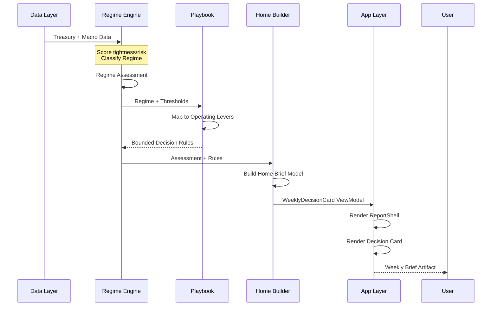
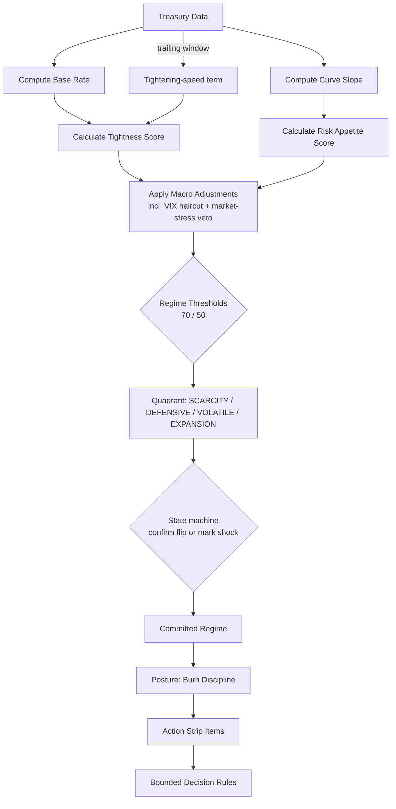
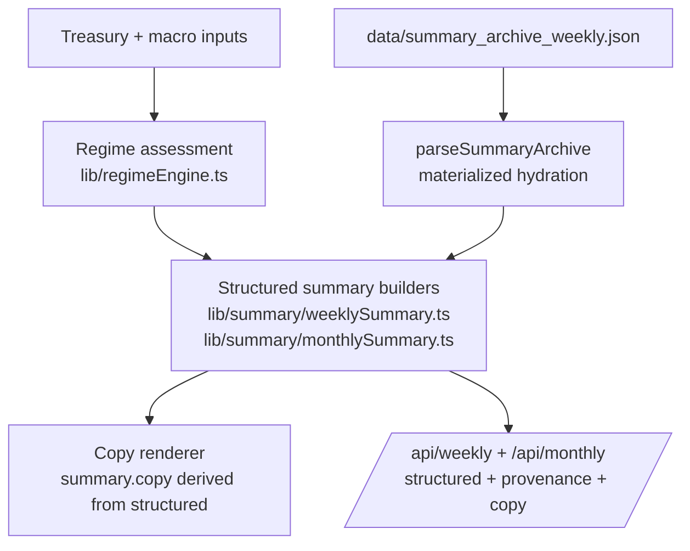
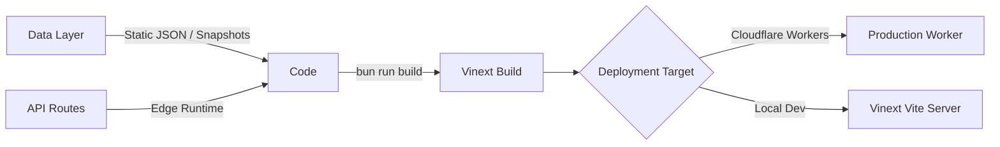

# Architecture overview

> **Status**: Canonical architecture document for Whether. Describes system boundaries, deterministic pipelines, module responsibilities, and extension points.

---

## What this system does in plain English

Whether is not a generic macro dashboard.

It pulls in a small set of public market and macro signals, decides what kind of operating environment those signals imply, translates that into practical guidance, and packages the result into a brief that a founder or product leader can read quickly and share with a team.

In simple terms, the product answers four questions:

- What changed this week?
- What kind of environment are we in?
- What should we tighten, loosen, or revisit?
- What can we share in a meeting or Slack without rewriting it from scratch?

The architecture is built around that flow:

**signals → posture → decisions → shareable artifact**

---

## System overview

Whether turns public macro signals into a weekly operating read for startup and product leaders.

The system is not mainly trying to teach macroeconomics. It is trying to help an operator make a faster call about what to do next.

At a high level, the product works like this:

1. Collect market and macro signals.
2. Turn those signals into a simple read on the current environment.
3. Map that environment to operating guidance.
4. Render the result as a brief, decision card, answer page, or export.

The architecture is optimized for **decision transmission**: turning noisy inputs into a recommendation that can be scanned quickly, acted on, and shared with other people.

---

## High-level architecture diagram

This diagram shows the core path through the system. Data comes in, the core logic interprets the environment, report builders shape that interpretation into something presentable, and the app turns it into pages and exports.

```mermaid
graph TB
    subgraph "Data Ingestion Layer"
        A1[Treasury API] -->|Yields + Data| A2[treasuryClient.ts]
        A3[Macro Sources] -->|Signals| A4[snapshot.ts]
        A2 --> A5[treasuryNormalizer.ts]
        A4 --> A5
        A5 --> A6[sensors.ts]
    end
    
    subgraph "Core Logic Layer"
        A6 --> B1[regimeEngine.ts]
        B1 -->|Regime Assessment| B2[playbook.ts]
        B2 -->|Operating Levers| B3[boundedDecisionRules.ts]
        B1 -->|Diagnostics| B4[homeBriefModel.ts]
    end
    
    subgraph "Report Assembly Layer"
        B3 --> C1[homePageAssembler.ts]
        B4 --> C1
        B1 --> C2[reportData.ts]
        C2 --> C3[summary/* builders]
        C3 --> C4[weekly/monthly/quarterly/yearly]
    end
    
    subgraph "App Layer"
        C1 --> D1[/app/page.tsx - Weekly Brief]
        C2 --> D2[/signals - Evidence]
        C3 --> D3[/resolve - Resolve]
        C4 --> D4[/api/* endpoints]
    end
    
    subgraph "Artifact Layer"
        D1 --> E1[Weekly Brief UI]
        D2 --> E2[Signals Explorer]
        D3 --> E3[Decision Answer Pages]
        D4 --> E4[API Exports]
        E1 --> E5[Slack Brief / Board Annex Export]
        E2 --> E5
        E3 --> E5
        E4 --> E5
    end
    
    style B1 fill:#e1f5ff
    style B2 fill:#e1f5ff
    style C1 fill:#fff4e6
    style D1 fill:#fff4e6
```

---

## Data flow: Signals → Posture → Decision → Artifact

This is the product's main loop in plain English: gather signals, classify the moment, map that to action, and hand the user something usable.



---

## Regime classification logic

This is the central compression step in the system. Instead of asking the user to interpret raw macro data directly, Whether converts that data into a smaller set of operating environments.



### Regime definitions

| Regime | Tightness | Risk Appetite | Plain-English meaning | Default posture |
|--------|-----------|---------------|-----------------------|-----------------|
| SCARCITY | > 70 | ≤ 50 | Capital is expensive and lenders are pulling back | Tighten aggressively |
| DEFENSIVE | > 70 | > 50 | Capital is expensive but funding stays selective | Preserve capital and be selective |
| VOLATILE | ≤ 70 | ≤ 50 | Capital is cheaper but funding is wary | Monitor closely and avoid overcommitting |
| EXPANSION | ≤ 70 | > 50 | Capital is available and financing conditions are supportive | Loosen selectively and invest |

---

## Core module breakdown

These modules form the core reasoning path of the product. They matter more than the UI because this is where raw signals become posture, guidance, and final output.

### `lib/regimeEngine.ts`

The core classification engine. It takes normalized market inputs and decides what kind of environment the operator is in.

`evaluateRegime()` is a composition of two steps. `scoreRegime()` (`lib/regimeEngineScoring.ts`) is the
deterministic scorer and writes no copy: profile, contributors, warnings, the machine's transition cause and
policy refusals come out as codes. `describeRegimeAssessment()` (`lib/report/regimeDescription.ts`) writes
those codes into the stored `RegimeAssessment`, string for string, so every caller and every stored shape
is unchanged. A wording edit is therefore a commit to `lib/report/`, never to a scoring file — but the
strings are still stored (the month walk keeps `description`, the generators write the archives), so it
still rewrites archived text on the next regeneration.

**Key Functions:**
- `evaluateRegime()` — Main scoring function; accepts a threaded machine snapshot and a context carrying base-rate history
- `computeTightnessScore()` — Base-rate ramp + curve-inversion points + tightening-speed term → tightness
- `computeRiskAppetiteScore()` — Curve slope → risk-appetite proxy (a monetary-expectations read, not observed market appetite)
- `applyMacroAdjustments()` — Macro corroboration: HY spread, Chicago FCI, VIX haircut, and the market-stress veto (VIX 10-obs mean ≥ 30 caps the proxy at the regime line; 22–30 caps it 5 points above)
- `classifyRegime()` — Instant quadrant read for point queries and what-if scenarios; no machine state

**Flip governance (`lib/regimeStateMachine.ts`):**
- A flip commits after two consecutive confirming observations (one when clear of boundaries and at HIGH confidence)
- A crossing that jumps its line by ≥ 25 points in one step, from a reading outside the 5-point near band, commits immediately and is marked `shock` — no published reversal condition could have fired — and the call publishes at LOW confidence with an explicit warning. A jump that started inside the band is not a shock, however large: the warning could have fired, so the flip confirms through the gate like any other
- Archive and replay paths thread the same machine state the live path does, so `/history` and the weekly archive grade the same flips

**Outputs:**
```typescript
{
  regime: "SCARCITY" | "DEFENSIVE" | "VOLATILE" | "EXPANSION";
  thresholds: { tightnessRegime: number; riskAppetiteRegime: number };
  scores: {
    tightness: number; riskAppetite: number;
    baseRate?: number; curveSlope?: number | null;
    baseRateVelocityPoints?: number; baseRateVelocityDelta?: number;
  };
}
```

### `lib/playbook.ts`

Maps each regime to practical operating guidance. This is the layer that turns environmental assessment into advice about how to behave.

**Key Functions:**
- `buildPlaybookGuidance()` — Get stop/start/fence guidance for a regime
- `buildCanonicalBoundedDecisionRules()` — Create threshold-based rules

**Operating Levers:**
```typescript
type OperatingLeverKey = 
  | "burn-discipline"
  | "capital-raising"
  | "expansion-bets"
  | "hiring"
  | "product-tempo";
```

### `lib/report/homeBriefModel.ts`

Builds the main homepage brief model. It combines the regime call, operating guidance, and recent context into a structure the UI can render cleanly.

**Key Functions:**
- `buildHomeBriefModel()` — Core assembly function
- `buildWeeklyDecisionCardViewModel()` — UI view model builder

### `lib/report/homePageAssembler.ts`

Composes the full homepage. It coordinates data loading, model assembly, and section-level output so the weekly brief arrives as one coherent page.

**Key Functions:**
- `assembleHomePage()` — Full page assembly
- `buildCommandBarPayload()` — Command center data

---

## App layer structure

The app layer delivers the outputs of the reasoning system across the primary workflow routes:

```
app/
├── page.tsx                          # Homepage (Weekly Brief: /)
├── operate/                          # Plan workflow (/operate)
│   └── page.tsx                      # 4-step progressive execution stepper
├── signals/                          # Evidence workflow (/signals)
│   └── page.tsx                      # Dual-mode sensor array & diagnostics
├── resolve/                          # Resolve workflow (/resolve)
│   └── page.tsx                      # Action-first role translation & toolkits
├── trust/                            # Trust hub (/trust)
│   └── page.tsx                      # System status, source board, formula ref
├── history/                          # Archive & compare (/history)
│   └── page.tsx                      # Multi-quarter timeline & board annex export
├── api/                              # JSON, agent, and cadence endpoints
│   ├── weekly/                       # Weekly summary payload
│   ├── monthly/                      # Monthly summary payload
│   ├── agent/                        # Agent-formatted brief API
│   ├── mcp/                          # MCP streamable-HTTP transport (JSON-RPC)
│   └── og/                           # Live Open Graph preview generator
└── components/                       # Shared UI components
    ├── DecisionHero.tsx              # Primary weekly decision card + shortcuts
    ├── CadenceCallCard.tsx           # Monthly/quarterly lead for the cadence selector
    ├── illustrations/                # Threshold rails, delta and regime glyphs, trend marks
    ├── commandPalette.tsx            # Cmd+K palette
    └── KeyboardShortcuts.tsx         # Global keyboard handlers
```

---

## API layer

The API layer exposes the same core reasoning in machine-readable form.

### Summary APIs (`/api/*`)

| Endpoint | Method | Purpose |
|----------|--------|---------|
| `/api/weekly` | GET | Weekly summary copy + structured fields |
| `/api/monthly` | GET | Monthly summary with structured output |
| `/api/quarterly` | GET | Quarterly summary payload |
| `/api/yearly` | GET | Yearly summary payload |
| `/api/summary-delta` | GET | Structured diff between cadences |

### Decision & Alert APIs

| Endpoint | Method | Purpose |
|----------|--------|---------|
| `/api/regime-alerts` | GET, POST | Read/create regime alert events |
| `/api/decision-memory` | GET, POST | List/create decision memory entries |
| `/api/alert-preferences` | GET, POST | Manage delivery preferences |
| `/api/decision-events` | GET | Retrieve regime transition events |

### Integration & Agent APIs

| Endpoint | Method | Purpose |
|----------|--------|---------|
| `/api/mcp` | POST | MCP streamable-HTTP transport (JSON-RPC 2.0) |
| `/api/agent` | GET | Plain JSON weekly posture for LLM context |
| `/api/integrations/weekly-mandate` | GET | Destination-specific weekly mandate payload |
| `/brief.md` | GET | Markdown-formatted operator brief |
| `/api/image/slide` | GET | The call as a 16:9 SVG meeting slide (`lib/export/meetingSlideExport.ts`) |
| `/api/export/board-slide` | GET | The same slide as a one-slide PPTX or one-page PDF (`lib/export/boardSlideDeck.ts`); both read `lib/export/exportSnapshot.ts` |
| `/api/billing/checkout` | POST | Create Stripe Checkout sessions |
| `/api/billing/webhook` | POST | Stripe webhook receiver |

---

## Data layer

The data layer uses structured files, live fetchers with fallback caches, and KV persistence.

### Primary data files (`/data/`)

| File | Purpose |
|------|---------|
| `macro_snapshot.json` | Current macro indicators with sources |
| `weekly_summaries_2018_2026.json` | Historical weekly briefs |
| `monthly_summaries_2012_2025.json` | Monthly summaries |
| `summary_archive_weekly.json` | Materialized weekly archive |
| `recommendations.ts` | Playbook insight database |

### Cache & fallback files

| File | Purpose |
|------|---------|
| `snapshot_fallback.json` | Offline baseline for latest Treasury reading |
| `time_machine_cache.json` | Accelerates historical queries; each entry carries the period's daily VIX tail and base-rate velocity pair so the runtime replay matches the archive generators |

---

## Summary structure pipeline



---

## Loop stage module boundaries

Hard lines between data prep, decision logic, and presentation:

### 1) Signals (normalize and readiness)
- **Owner modules:** `lib/report/reportData.ts`, `lib/fred.ts`, `lib/sensors.ts`
- **What this layer does:** fetch, clean, and normalize signals; prepare data for downstream scoring
- **Must not depend on:** React UI modules, route rendering

### 2) Posture + decision derivation
- **Owner modules:** `lib/report/homeBriefModel.ts`, `lib/report/decisionKnobs.ts`, `lib/report/operatingCalls.ts`, `lib/playbook.ts`
- **What this layer does:** classify environment, derive posture and bounded rules, produce stable view models
- **Must not depend on:** React UI modules

### 3) Presentation + artifact transmission
- **Owner modules:** `app/components/DecisionHero.tsx`, `app/components/CadenceCallCard.tsx`, `app/operate/components/*`
- **What this layer does:** render the brief, decision card, and export surfaces; make the output fast to scan, copy, and share
- **Must not do:** threshold scoring, regime classification

---

## Deployment architecture



---

## Related documentation

- [`one-screen-weekly-brief-spec.md`](./one-screen-weekly-brief-spec.md) — Weekly brief layout contract
- [`feature-specs-current.md`](./feature-specs-current.md) — As-built feature specifications
- [`developer/api-reference.md`](./developer/api-reference.md) — API endpoint contracts
- [`developer/quickstart.md`](./developer/quickstart.md) — External developer quickstart
- [`use-cases/operator-playbooks.md`](./use-cases/operator-playbooks.md) — Role-specific operator workflows
