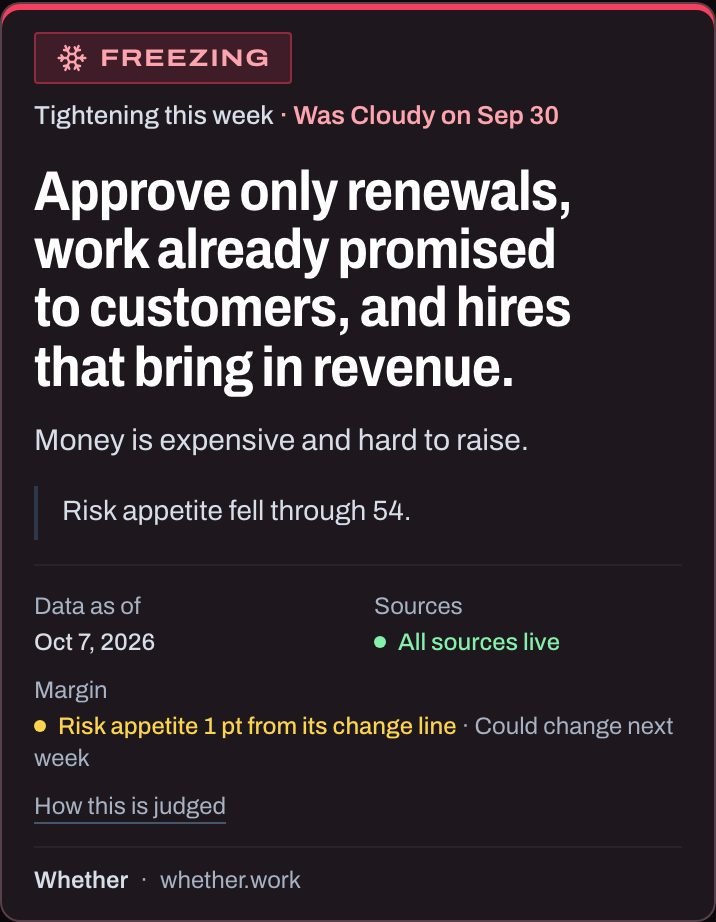
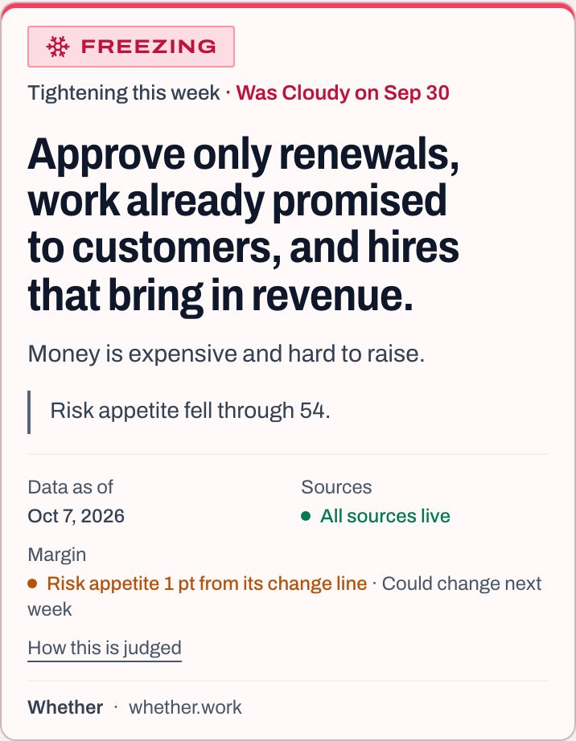
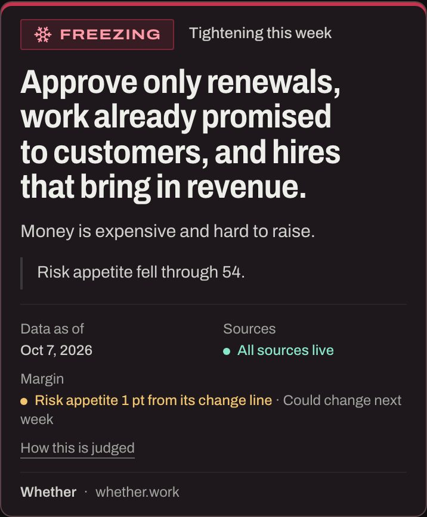
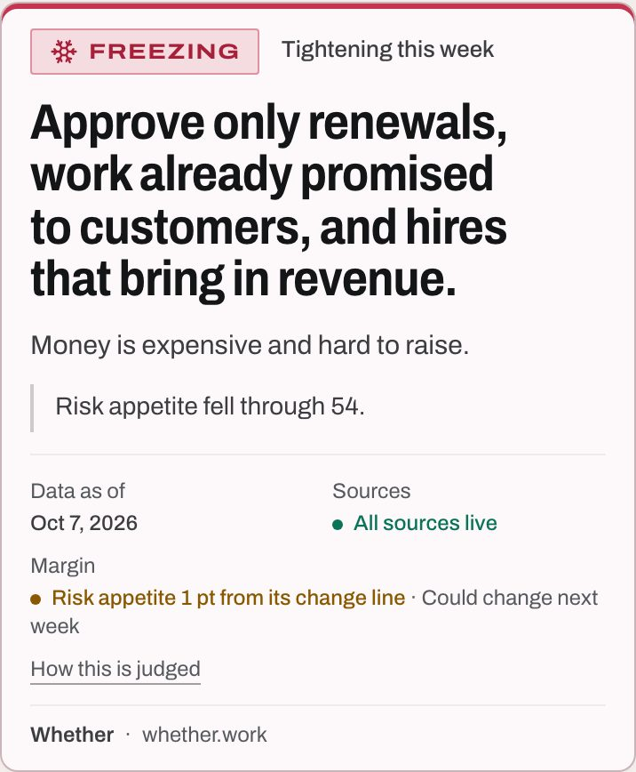
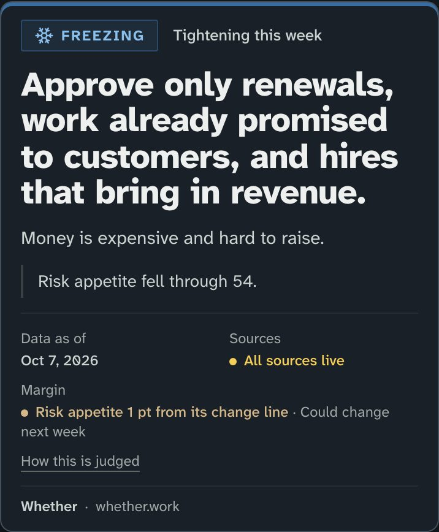
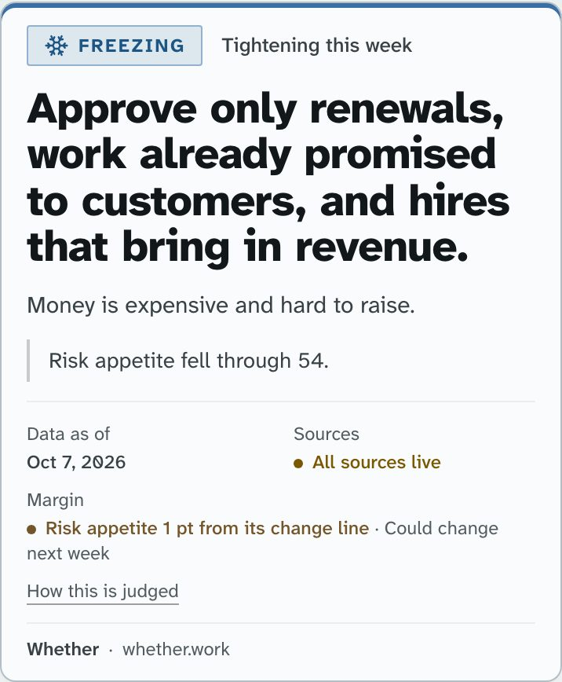
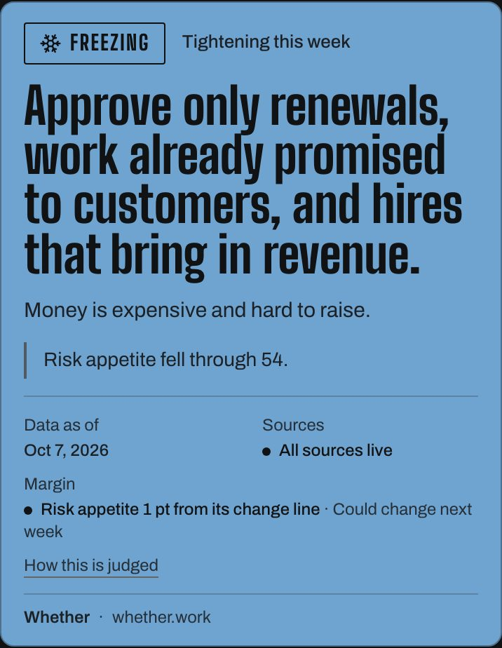
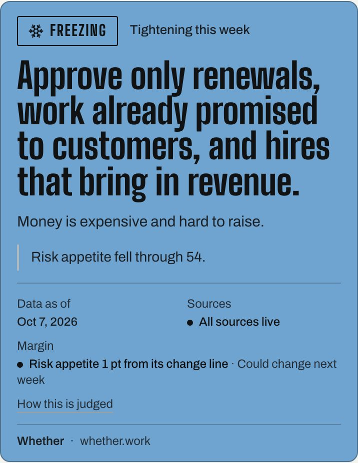

# Palette and type directions (decision record)

Status: decided, 2026-10-09. The owner chose Synoptic, as recommended below: its colours with the
shipped type, and dark kept as the default theme. `docs/feature-specs-current.md` §1.1.69 records
what was applied, including the one set of condition fills used in both themes and the line
states' own tokens. The mockup routes still 404 in production (`app/mockups/layout.tsx`); the
preview lane and local dev keep them, and they now draw over the applied palette.

## The question

A design audit found the site's look sits in a common generated-design default. The page is
near-black, with four stock Tailwind 500 accents (emerald, amber, violet, rose), sky links and
slate text. The light theme is a cream ground, the other default. The trope-removal PR takes
decoration out. This record asks whether the identity itself should change, and offers three
answers.

## How to look at them

| Direction | Route |
| --- | --- |
| Instrument | `/mockups/palette/instrument` |
| Synoptic | `/mockups/palette/synoptic` |
| Warning card | `/mockups/palette/warning-card` |

Each route draws the shipped components with this week's reading:

- the call card, with the conditions chart beside it (under it on a phone);
- the area cards and the folded all-areas table;
- the Decide rules table;
- the `/history` band.

The site's theme toggle switches each route between dark and light.

Nothing is forked. Each direction is a stylesheet beside its page (`<direction>/tokens.css`) that
names its values as `--p-*`. `app/mockups/palette/paletteBase.css` points the site's own tokens
at those values with `:root:has([data-palette])`, so the redirect only matches while a mockup page
is mounted. New faces are subset to the same Unicode range as Archivo and live in
`app/mockups/palette/fonts/`. They are OFL, and the licence text is in each file's name table.

## The constraint the directions share

Measured on the live palette: for a reader with deuteranopia, Sunny's emerald and Freezing's rose
come out 5.6 apart. That is OKLab distance ×100, after Machado-2009 simulation at full severity;
below about 5 two swatches read as one side by side. Those two are the best and the worst
conditions. All three directions fix this the same way: the four colours differ in lightness as
well as hue, and warm alternates with cool. Red-green deficiency keeps the blue-yellow axis and
lightness, so those are the two things the colours have to differ on.

All three also drop the sky action accent. Links, buttons and focus rings take the text ink, and
links keep their underline. A fifth hue that means "click" is the main reason the current page
reads as several bright accents, and it was what forced Stormy to violet.

## Instrument: keep the current identity, refined

**Plan.** Dark first. Type unchanged.

| Name | Dark | Light | Role |
| --- | --- | --- | --- |
| Graphite / Paper | `#0b0c0d` | `#f5f5f2` | ground |
| Chalk / Ink | `#eeeeea` | `#141517` | text and action |
| Verdigris | `#54d8b1` | `#3ba888` | Sunny |
| Brass | `#e29936` | `#b77d29` | Cloudy |
| Iris | `#8264e7` | `#7e60e2` | Stormy |
| Signal | `#c4334f` | `#c53550` | Freezing |

- **Type:** Archivo in three widths, with Chivo Mono for figures, as shipped on 2026-10-05.
- **Layout:** no change.
- **Signature:** the regime stamp and the card's top rule are the only colour on the page.

**Critique.** It is still near-black with four accents, which is the trope. The case for it: the
audit's complaint is accent count and stock values more than the dark ground, and this fixes both
at the lowest cost. The neutral greys replace slate-blue, and the light theme moves off cream to a
neutral paper. Revised from the first plan:

- A refined steel-blue action accent was cut: a fifth hue is what the audit named.
- The atmosphere went from 8% to 4%: the first capture dyed a Freezing week's first screen maroon.

Seen side by side with the live card, the change is small. That is the honest result of this
option.

## Synoptic: a daylight weather chart

**Plan.** Light first. The four colours are a coordinate system, not a set.

| Name | Light | Dark | Role |
| --- | --- | --- | --- |
| Chart paper / Night chart | `#f1f4f3` | `#0f1316` | ground |
| Ink | `#121719` | `#edf0ee` | text and action |
| Sun | `#ba9320` | `#f2c230` | Sunny: warm, clear |
| Haze | `#997444` | `#a3824e` | Cloudy: warm, dense |
| Lightning | `#7f84c6` | `#a3abf7` | Stormy: cool, clear |
| Frost | `#3a6fa3` | `#3a6ea3` | Freezing: cool, dense |

Warm means risk appetite is on (Sunny, Cloudy) and cool means it is off (Stormy, Freezing). Light
means money is cheap (Sunny, Stormy) and dense means it is dear (Cloudy, Freezing). The chart's two
axes become the two things colour can carry, and each hue is the weather its word names.

- **Type:** Atkinson Hyperlegible Next at 800 for display and 400 for text, with Atkinson
  Hyperlegible Mono for figures. The card is read shrunk inside someone else's deck, where 6 and 8
  or 1 and l must not blur. Neither file draws arrows; they fall to Archivo, as Chivo Mono's do today.
- **Layout:** light theme as the default. A dark slab pasted into a white deck is a black box.
- **Signature:** the conditions chart, whose quadrant washes carry the colour field.

**Critique.** Revised from the first plan:

- The first set was a weather-icon palette: grey Cloudy, ice-blue Freezing, violet Stormy. For a
  deuteranope that is three blues (measured minimum 7.8), so it became the bivariate system above.
- A cream chart paper was rejected as default one, for a cool green-grey.
- A hairline chart grid behind the page was rejected as the broadsheet default.
- A serif display was rejected: on a light ground it lands on cream-and-serif.

The mockup shows one cost. The site ties Sunny's ink to the easing (clear) state and Cloudy's to
the caution state, so here "All sources live" and a crossed pause line print in gold and brass. On
the light theme those two inks are nearly the same brown. Applying this direction means untying
line states from conditions (see Recommendation).

## Warning card: a quiet page, a card printed in the week's colour

**Plan.** Weather services issue warnings as a colour you can read across a room. All of this
direction's boldness goes there.

| Name | Value | Role |
| --- | --- | --- |
| Ink / Paper | `#111213` / `#f4f4f1` | the page, no accent |
| Sun slab | `#fed756` | Sunny card, ink 13.5:1 |
| Lightning slab | `#bebdfa` | Stormy card, ink 10.6:1 |
| Haze slab | `#c7a475` | Cloudy card, ink 8.0:1 |
| Frost slab | `#70a4d0` | Freezing card, ink 7.1:1 |

- **Type:** Big Shoulders Display, the City of Chicago's condensed signage face, for the call and
  the regime stamp only. Archivo for text, Chivo Mono for figures.
- **Layout:** the call card is a solid slab with near-black ink in both themes. A pasted card looks
  the same whichever theme the sender was reading in.
- **Signature:** the slab.

**Critique.** This is the risk. Revised from the first plan:

- The first build set every heading in Big Shoulders, so the display face stopped being rare. It
  is now on two elements.
- The first slabs put Stormy and Freezing at the same lightness (deuteranopia 4.5), so they were
  spaced.

Two costs remain. The condition becomes the loudest thing on the page every week, louder than the
call it qualifies. And Freezing, the most severe condition, is a calm blue.

## Screenshots

The images are in `docs/assets/palette-directions/`. Each direction has:

- the page at 1280 and 390, in dark and light;
- the call card at 390, cropped as it would be pasted;
- the card and the `/history` band in greyscale.

`current-card-*` is the live card for comparison.

| | Dark | Light |
| --- | --- | --- |
| Live card |  |  |
| Instrument |  |  |
| Synoptic |  |  |
| Warning card |  |  |

**Greyscale.** In every direction the condition glyph on each run of the band and on the chart's
corners carries the meaning when colour is gone. The four greys are also distinct in each set.
The pause, dashed-circle and play glyphs tell line states apart in every set. Each direction's
`*-band-*-gray.png` and `*-card-1280-*-gray.jpg` show this.

**Pasted card.** Each card names its source inside its border ("Whether · whether.work") and
holds its date and margin. The Warning card is the only one that reads the same from both themes.

## Contrast and colour-vision results

The ratios are WCAG contrast. The vision columns give the closest pair of the four condition fills
after simulation, as OKLab distance ×100: about 10 or more reads as distinct, and under 5 as the
same.

| Direction | Theme | Text / secondary / muted on ground | Lowest condition ink (on ground, on panel) | Deuteranopia | Protanopia | Tritanopia | Greyscale |
|---|---|---|---|---|---|---|---|
| Live | dark | 18.5 / 14.7 / 9.4 | Freezing 10.53 / 9.59 | 5.6 (Su–Fr) | 8.9 (Su–Cl) | 16.5 (Su–St) | 3.5 (St–Fr) |
| Live | light | 16.8 / 9.8 / 7.1 | Cloudy 4.74 / 5.02 | 5.6 (Su–Fr) | 8.9 (Su–Cl) | 16.5 (Su–St) | 3.5 (St–Fr) |
| Instrument | dark | 16.8 / 12.7 / 7.8 | Freezing 9.73 / 8.93 | 13.1 (Su–Cl) | 17.2 (Su–Cl) | 20.8 (Cl–Fr) | 5.4 (St–Fr) |
| Instrument | light | 16.7 / 10.0 / 6.5 | Sunny 5.33 / 5.82 | 9.5 (Cl–Fr) | 12.7 (Su–Cl) | 13.1 (Su–St) | 3.6 (St–Fr) |
| Synoptic | dark | 16.3 / 12.3 / 7.8 | Freezing 9.66 / 8.88 | 21.4 (Cl–Fr) | 17.5 (Cl–Fr) | 16.2 (Su–St) | 7.4 (Su–St) |
| Synoptic | light | 16.3 / 9.4 / 6.2 | Sunny 5.89 / 6.51 | 10.8 (St–Fr) | 9.1 (St–Fr) | 9.8 (Su–Cl) | 4.9 (Su–St) |
| Warning card | dark | 16.4 / 12.4 / 7.7 | Freezing 9.50 / 8.73 | 12.3 (St–Fr) | 10.3 (St–Fr) | 11.1 (Su–St) | 3.5 (Cl–Fr) |
| Warning card | light | 17.0 / 10.5 / 6.7 | Sunny 5.91 / 6.51 | 12.3 (St–Fr) | 10.3 (St–Fr) | 11.1 (Su–St) | 3.5 (Cl–Fr) |

Every text role and condition ink clears AA (4.5:1) on its ground and panel in all three
directions. The band's black glyph clears 3:1 on every fill in every direction. The lowest is
3.06, Synoptic's Frost on the dark theme.

## Recommendation

**Apply Synoptic's colour system and keep the shipped type.**

- **Why Synoptic.** It is the only direction that changes the identity rather than tidying it. Its
  colours come from the product's own subject: the weather each word names, arranged on the two
  axes the chart already draws. It also has the best colour-vision result of the three on the dark
  theme. Instrument fixes the same accessibility defect, but its card is hard to tell from today's.
  Warning card makes the best pasted artifact, but it makes the condition louder than the call,
  and it is the hardest to bring the OG cards, slide and email along with.
- **Why keep Archivo.** It shipped on 2026-10-05 with a measured fallback and its own share-card
  instances, and the width voices still do their job. A semi-condensed call holds fewer lines on a
  phone than Atkinson at 800, which reads as signage. The audit's complaint was colour. Atkinson
  stays a separate decision: it would mean new fallback metrics, new OG instances and a re-measured
  `lib/image/textFit.ts`, and ui-ux-standards §XVIII ("one family, three widths") would have to change.
- **One change beyond the mockup.** Untie line states from conditions. A crossed or close pause line
  takes its own ink, a front red. A clear line takes the neutral ink, and the play glyph says
  "clear". Cloudy then stops meaning caution, and Sunny stops meaning clear. The radar's corner
  words read condition tokens instead of the line-state families.
- **Default theme.** Kept dark in the first application. Making light the default is one line in
  the theme bootstrap, and it is the owner's call once both themes have been seen live.

## Conflicts with repo rules

- Synoptic's Atkinson and Warning card's Big Shoulders would each break §XVIII ("NEVER: add a serif
  or a second sans"). Neither is recommended for now.
- Dropping sky as the action accent leaves `tests/regimeColourContract.test.tsx`'s rule standing
  (no regime on the sky ramp), with nothing on the sky ramp at all.
