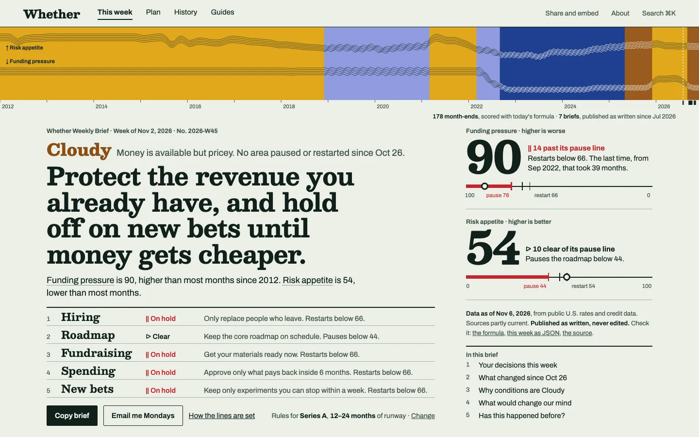

# Rebuild direction: Covenant (working brief)

Status: working, 2026-11-10. The owner chose the direction and the first build landed the same
day: the tokens, the type, the record band on every route, the first screen of the brief and
History. "What is built" below says exactly what, and what is not yet.

This brief replaces the visual world of the site and keeps the product: the same guidance, lines,
routes and copy rules. Read it before extending the rebuild. `DESIGN.md` describes the site as
built; where the two differ, `DESIGN.md` is what shipped and this is what was intended.

## What the owner decided

| Question (2026-11-10) | Answer |
| --- | --- |
| How much may change | Replace the visual world. Product truth stays: the weather vocabulary, the lines, the copy rules, both themes, the record. |
| Whose respect to win, beyond founders and their operators | Engineers arriving from Hacker News or GitHub, investors and accelerators, designers and product peers. |
| What would make a polished result wrong | Reading as a SaaS landing page, a trading terminal or a newspaper pastiche; spectacle that slows the Monday read. |
| Direction | Covenant, picked from the hand in the appendix. |
| How it lands | One pull request for the whole site. |
| How far the band goes | The vector band with a month readout on every route, and a canvas rendering on History. |
| What History says where the two records differ | The two facts, with no cause. |
| The theme on arrival | The device setting, unless the reader has stored a choice. |

The goal in the owner's words: the site should instil awe and reliability in the readers and in
the people whose respect or collaboration Whether wants.

## The pictures

Static first screens, drawn from the week of Nov 2, 2026 and the bundled monthly record. Area
lines are shortened ("Restarts below 66" omits the risk-appetite condition); the real strings
come from the model.

| View | File |
| --- | --- |
| This week, desktop | [home-desktop.webp](rebuild-covenant/home-desktop.webp) |
| This week, phone | [home-phone.webp](rebuild-covenant/home-phone.webp) |
| This week, dark theme | [home-dark.webp](rebuild-covenant/home-dark.webp) |
| History, desktop | [history-desktop.webp](rebuild-covenant/history-desktop.webp) |

## What is built

As of 2026-11-10, on every route unless a line says otherwise:

- **Tokens.** Both themes' ground, ink, borders and line red; the four condition fills and their
  text inks; smaller radii; no shadow on a surface. The action colour is the ink.
- **Type.** Besley, self-hosted with Georgia stand-ins, for headings, the guidance, the condition
  word, area names and score figures. The condition word is a word in its ink, not a placard.
- **The record band,** under the navigation: fields, the two line bundles with a pattern per
  condition, a mark for each published brief, a yearly axis, and the month readout with keyboard
  and touch. On History it opens to the page's figure and a canvas redraws it denser.
- **This week.** The guidance block without its card; the two scores as figures on their ladders
  in the margin from `md` up, and the nearer one on a phone; the conditions map in "What would
  change our mind"; the five areas numbered.
- **History.** A cell for each week since the first brief, empty where none was published, and
  a note of both facts where a brief and its month-end name different conditions.
- **Theme.** The device setting picks it when nothing is stored.
- **Palette copies.** Share images, emails, the badge, the web manifest and the brand kit.

Not built yet:

- The action sentence beside each area on the first screen. The areas are numbered and state
  their standing; each action is still in "Your decisions this week", directly below.
- One copy control on the first screen. The four copy buttons remain.
- Numbered section openers and the contents list in the margin.
- The trust facts in the margin. The trust strip is still under the areas.
- Share images, emails and print redrawn with the band and Besley. They took the palette only,
  and are still drawn dark.
- The week's move redrawn for the band. It keeps its existing choreography on the ladders and
  the condition word.
- The moments in "Moments worth authoring": a crossed line citing the brief that set it, brief
  numbers on the page, and a copy confirmation that names the brief.
- `/trust`, `/operate`, `/signals` and the answer pages beyond the frame, tokens and type.

## Why rebuild: what the reviews found

Two independent reviews of the shipped site ran the same day.

**Design review, 20 of 32 on the heuristics that apply (acceptable, nothing blocking).**

- The proof is far from the claim. The record band is section eight of `/`, 24px tall, with no
  year axis. The misses, the formula and the author are a click or more away.
- Two records share one name. 178 month-ends are scored today with the current formula; the
  unedited archive is 7 briefs, the first from Jul 30, 2026. Four briefs were published as
  Freezing in Sep and Oct 2026, and the monthly record now reads those months as Cloudy.
- The first screen carries three verdicts, four dates and about thirty targets.
- What could only be Whether is drawn small: the map is 266px wide, the ladder track 4px.
- The site reads as several builds: three page grids, five stamp treatments, and the week's
  condition colour doubles as the action colour.

**Technical audit, 14 of 20 (good).** Tokens, font delivery, layout primitives and accessibility
mechanics are sound. The debt is client weight (every route loads and validates the 1.38 MB
time-machine dataset; `/` parses 1.9 MB of script), 2,501 call sites that name a Tailwind hue
and mean a role, and two drag surfaces that block touch scroll and have no keyboard path.

## 1. Job and audience

A founder opens the brief on a Monday, on a phone or at a desk in daylight, with a decision in
flight. They need this week's guidance, whether anything moved, and where their lines stand, in
one screen. They then paste it into Slack or print it for a board pack.

The peers arrive cold and sceptical. The engineer expects a macro horoscope and looks for the
catch. The investor asks whether it is safe to forward. The designer judges the craft.

The surface is a document that is read, so the page is a document first: standard navigation, a
calm reading column, and a frame that could belong to no other product.

## 2. Outcome and proof

- **Monday reader:** guidance, the delta and all five standings on the first screen at 390px
  and at 1440px, with no scroll.
- **Cold visitor:** within ten seconds, can say what this is and has seen how long the record is.
- **Proof on hand:** 178 month-end readings since Jan 2012 under one published formula; 7
  changes of conditions; 7 briefs kept as written; the misses, printed.
- **Uninventable:** no testimonials, logos or usage numbers. The design shows only what
  `PRODUCT.md` lists as evidence.

## 3. The direction

**Thesis.** The lines are a policy agreed in advance, and the weekly brief is the dated statement
of where each one stands. The page is that statement, on paper whose only ornament is the record
itself.

**It refuses** the dark data panel with glowing accents, and its opposite, the cream editorial
page with an italic serif masthead.

**The name is internal.** "Covenant", "certificate", "compliance" and "attestation" never appear
in reader copy. `docs/editorial-guardrails.md` forbids implying legal or compliance advice, and
the world borrows a discipline, not a vocabulary. No new reader term is minted: guidance,
conditions, pause line, restart line and brief keep their one name each.

**Five disciplines**, each taken from a direction the hand declined:

1. **Structure is the only ornament.** Every engraved line is drawn from the record. Nothing
   decorative is added anywhere.
2. **Fill is the state, length is the duration.** Each condition has its own line pattern as well
   as its ink, and the band is drawn to true time.
3. **Nothing overflows the sheet.** The brief fits one screen on a phone and on a desktop.
4. **One cord.** Stage and runway are a single control, and it re-sets every rule on the page.
5. **Label the drawing in place.** Each line and tick names itself where it sits. No legends.

## 4. The system

### Colour

Light is the identity, because the brief is read in daylight and ends up on paper. Dark ships as
a composed second theme. Colour still carries two meanings and nothing else: the four conditions,
and a crossed line.

| Role | Light | Dark |
| --- | --- | --- |
| Paper (ground) | `#ecf0e8` | `#0c1511` |
| Ink | `#10201a` | `#e6ece2` |
| Secondary ink | `#40524a` | `#a3b2a9` |
| Sunny fill | `#e0a81c` | same |
| Cloudy fill | `#9a5b1e` | same |
| Stormy fill | `#8f9be0` | same |
| Freezing fill | `#1f3f8f` | same |
| A line crossed | `#c4242b` | `#f0666a` |

These are sketch values, measured once:

- Text passes AA in both themes: ink 14.6:1 and 15.4:1, secondary ink 7.2:1 and 8.4:1, the red
  5.0:1 and 6.0:1.
- The four fills keep the October rule (warm against cool, light against dense). Their closest
  pair is 23.7 apart in OKLab ×100 under simulated protanopia, where about 5 reads as one colour.
- Sunny and Stormy have almost equal lightness (1.2:1), so a greyscale print separates them by
  line pattern and label only. Each boundary between stretches needs a hairline.
- Freezing is 1.9:1 against the dark ground, so the band takes a hairline edge in the dark theme.

Changes from the shipped rules:

- **Action colour is ink.** Links are underlined ink; buttons are solid or outlined ink. The
  week's condition no longer colours controls.
- **Red is audited back to one meaning.** A miss in the change log takes the hollow-ring caveat
  and plain ink, not red.
- **Colour commits at page scale** in one place, the record band. The condition word beside the
  guidance is the only other coloured element on the first screen.

### Type

Two voices and one role face.

- **Besley, the binding voice.** A Clarendon, listed on Google Fonts under the OFL; confirm the
  licence file when self-hosting. It sets the guidance, the condition word, area names, score
  numerals, page titles and the wordmark. Clarendons are the face of engraved securities and
  public notices, and at display sizes they read sturdy and calm where the shipped condensed
  bold reads urgent. The numerals give the two scores a typographic role they lack today.
- **Archivo, the explaining voice.** Kept, with its files, preload and fallback faces. Body,
  rule sentences, labels and controls. Widths 87.5 and 100 only; the expanded stamp goes.
- **Chivo Mono** only where figures align in columns: tables, pasted previews.

Rules:

- Labels are sentence case and untracked, as `tests/typeRegister.test.tsx` already requires.
  The sketches from the direction round used tracked capitals and mono metadata; both were
  removed because they pull the page toward the generic editorial look.
- No italics, as today.
- The six-step fluid ladder stays for Archivo. Besley adds three roles: the guidance
  (29px at 390px, 51px at 1440px), section and page titles (27 to 44px), score numerals
  (46px phone, 92px desktop, fixed).
- The guidance is at most 101 characters (`tests/heroCallAssumptions.test.ts`), which sets five
  lines on a phone and four on a desktop.
- Prose keeps the 60ch measure.

### Layout

- **One frame on every route:** navigation, the record band, then the document. One left edge
  (96px desktop, 20px phone). This replaces four page shells.
- **Desktop:** an 800px reading column and a 384px margin column. The margin holds the two
  scores with their ladders, the trust facts, and the contents of the page.
- **Phone:** one column in this order: band, brief number, condition and delta, guidance, five
  areas, two scores. The bottom tab bar and the running head stay.
- **No cards.** Sections open with a number, a Besley heading and a 2px rule. Enumerable
  content is a table with hairline rows. Boxes remain for inputs, previews, dialogs and menus.
- **Navigation is unchanged:** This week, Plan, History, Guides; Share and embed, About, search.
  No route is renamed.

### The record band

The signature, present under the navigation on every route.

- **What it draws.** One slot per month from Jan 2012, then this week. Each stretch of
  conditions is a field in that condition's ink. Two bundles of fine lines run across it: risk
  appetite above and funding pressure below, so easier is up, as everywhere else. The line
  pattern changes with the condition: plain for Sunny, a slow wave for Stormy, a fine ripple for
  Cloudy, a zigzag for Freezing.
- **What it shows without a word.** Funding pressure sat at zero for a decade and reached 100 in
  2022. A visitor sees that before reading anything.
- **Two records, kept apart.** The engraved fields are the month-end readings, scored with
  today's formula. Published briefs are separate marks under the band, one per brief, starting
  at a dashed line where publication began. A week with no brief stays empty. The caption names
  both counts.
- **Sizes.** 150px tall on desktop, 84px on a phone, 300px on History, where it opens into the
  page's main figure with field labels and a yearly axis.
- **Interaction.** Moving along the band reads out that month in the caption row and links to
  its period. It is a slider with arrow keys, scrolls vertically under touch, and clears on
  cancel. Reuse the pointer handling in `app/components/TimelineBar.tsx`, the one complete drag
  surface.
- **Since you last read.** The existing `SinceLastVisit` behaviour moves onto the band as a
  mark at the last brief this browser opened. It needs no input.
- **Delivery.** Server-rendered SVG from the monthly history the read path already holds, with
  no client script for the still image. The readout is a lazy island.

### Components

- **Guidance block.** Brief number and week, the condition word with its gloss, the delta
  sentence, the guidance as the only `h1`.
- **Area rows.** Five numbered rows: area, standing with its glyph, the action and its line.
  A row opens its full rule in place, as the decision picker does today. The action sits beside
  "On hold", so a reader with a hire in flight sees the exception without scrolling.
- **Score block.** Label, numeral, one sentence of standing, and a ladder labelled in place with
  the pause side on the left. Both scores show at every width.
- **Trust facts.** The trust strip's facts, with one dated freshness fact on the first screen,
  "published as written" and three links to check it: the formula, the week as JSON, the source.
- **Contents.** The numbered sections of the page, in the margin on desktop.
- **Controls.** One copy control and one subscribe control on the first screen; other formats
  live on Share. 2px radius, 44px targets, the shipped focus ring and press motion.
- **Caveat.** The hollow ring, unchanged.

### Motion

- **A quiet week has no motion**, which is most weeks.
- **The week's move** keeps its contract (`tests/weekMove.test.tsx`): CSS keyed on a data
  attribute, transform and opacity, under two seconds, still under reduced motion, print and
  screenshot mode. It is redrawn in three steps. The band gains its newest slot, and a changed
  condition inks in from the boundary. The moved area's standing is struck and re-set. The
  score numeral counts from last week's value.
- **Routine feedback:** 120ms press, 150 to 200ms disclosure. The band readout has no easing.
- **Between weeks,** the document cross-fades and the band stays put.
- The scroll-progress rule goes; it competes with the band.

### Moments worth authoring

The reader should feel that someone kept the books.

- **A line named before it was crossed.** When a pause line is crossed, the brief cites the
  earlier brief that set it. This is the proof of "agreed in advance" that no page shows today.
- **The empty week.** A week without a brief is drawn as an empty slot, so a refusal to publish
  from a stale reading reads as a rule and not as a gap.
- **Brief numbers.** Each brief carries its number (2026-W45, the existing slug), and the band
  grows by one mark each Monday.
- **Specific confirmation.** Copying says which brief was copied.

## 5. Surfaces

| Surface | What changes |
| --- | --- |
| `/` | As drawn. First screen: band, guidance, five rows, two scores, one freshness fact. |
| `/history` | The band opens into the 300px figure. Published briefs and month-end readings sit side by side under their own names and counts, with a note where they differ. The change log prints its misses. |
| `/trust` | States its answer first. Sources become a table with cadence and last fetch. The formula is set as numbered definitions with its constants. |
| `/operate` | The reader's own lines in the same row form, with stage and runway as the one control. Board slide, investor update and portfolio note render in the same world. |
| `/brief/[week]` | The frozen brief. Its band ends at that week. Correction notes stay in place. |
| `/signals` | Delta first, then the two scores at full width with their ladders. |
| Answer and guide pages | The same frame and reading column, with current conditions, the implication and a link to the brief. |
| OG image, email, print, Slack paste | Band, guidance, five rows and the brief number. |

## 6. States and ranges

- **Guidance:** up to 101 characters.
- **Areas on hold:** zero to five. A Sunny week with all areas clear has no red on the page.
- **Week:** quiet, or one that moved.
- **Data:** live, partly current, stale, bundled fallback, an archived week, an unpublished week.
  A stale or fallback reading leaves the band's last slot empty and leads with the trust facts.
- **Reader:** first visit (the condition word carries its gloss) or returning (the mark on the
  band). Stage and runway band.
- **Display:** light, dark, print, screenshot mode, forced colours. Patterns keep the band
  legible where colour is removed.
- **Width:** 390px first, then 768, 1440 and 1600 and up.

## 7. What carries over

**Keep:** the guidance as the `h1`; action, pause line and restart line with a gap; easier is up
and right; red for a crossed line with a glyph and a word; the trust strip's facts; correction
notes and listed misses; stage and runway with a visible change control; the token roles, font
delivery, layout primitives, focus ring, skip link, disclosure contract and landmark rules.

**Drop:** panel-and-rail chrome; the four copy buttons after the guidance; the condition hue as
the action hue; proof set at 12 to 13px; miniature instruments; hue-named utilities; boxes built
from raw utilities; overlays imported statically from the root layout; stock stroke icons for
the five areas.

## 8. Tests the rebuild rewrites on purpose

Most UI tests hold structure and should stay green. These pin the look and change deliberately:

| Test | Change |
| --- | --- |
| `tests/regimeColourContract.test.tsx` | New condition values; the action colour becomes ink. |
| `tests/typeSteps.test.tsx` | Adds the three Besley roles beside the ladder. |
| `tests/fontAssets.test.ts` | Adds Besley's file, preload and fallback metrics. |
| `tests/surfaceDepthLadder.test.ts`, `tests/shapeRegister.test.ts` | Fewer surfaces, smaller radii. |
| `tests/themeRawPaletteRatchet.test.ts` | Falls as hue aliases are removed. |
| `tests/homeFirstScreen.test.tsx`, `tests/onePlacePerFact.test.tsx` | The first screen's facts move; the one-place rule stays. |

## 9. Budgets

- Text stays the largest paint. No image on the first screen.
- The band adds at most 10 KB compressed to a document and no client script until touched.
- Besley ships as one subset variable file, preloaded, with a metric-matched fallback.
- The time-machine import is fixed before the rebuild lands, so the new frame does not inherit it.
- No feature needs manual upkeep: the band, the marks and the brief numbers come from data.

## 10. Build order

Small PRs based on `main`, none stacked.

1. Prototype `/mockups/covenant` with live data: `/` at phone and desktop in both themes, and
   the top of History. Settle the open decisions there.
2. Tokens and fonts behind a root attribute, so both worlds render during the move.
3. The one frame and the band.
4. `/`.
5. History and Trust, with the two records separated.
6. Plan, Share, email, OG and print.
7. The long tail, then delete the old world and rewrite `DESIGN.md` from what was built.

## 11. Open decisions

Settled on 2026-11-10: how far the band goes, what History says where the records differ, and
the theme on arrival (the table at the top). Still open:

1. **Besley against an alternate.** Besley is built. The test on the hardest strings was not
   run: a 101-character guidance at 390px, the numerals 0 to 100, and the five area names at
   20px on a low-density Windows display. Hepta Slab is the alternate if it fails there.
2. **Per-area history.** A strip of held and clear months for each area would suit History. It
   needs a model function and the same "scored today" caveat.
3. **The condition fills on the other ground.** Sunny and Stormy are under 3:1 against the
   paper, and Freezing against the dark ground. Fields in the band are separated by a seam and
   a pattern; a small mark in one of those colours on its weak ground needs an outline or the
   condition's text ink.

## Appendix: the hand

The direction was dealt, not ranked: seven grounded candidates, a roll (seed `2b9b0296`) that
assigned the third, and six catalog challengers.

| Card | Outcome | Kept from it |
| --- | --- | --- |
| Covenant (credit agreements, security printing) | Chosen | |
| Standing (public status pages) | Offered as the familiar pick | Per-area history strips, as open decision 4 |
| Select rail (film cutting bench) | Offered as an alternate | |
| Exposed binding (Coptic bookbinding) | Declined | Structure is the only ornament |
| Movement score (Labanotation) | Declined | Fill is the state; length is the duration |
| J-card (cassette inlay) | Declined | Nothing overflows the sheet |
| Drawcord (a gathered cape) | Declined | One cord |
| Napkin zine (hand-drawn zines) | Declined | Label the drawing in place |
| The category standard (clean product page) | Offered as the standing exit | |

The other grounded candidates were aeronautical approach plates, printed railway timetables,
the audited ledger, scholarly apparatus and the avalanche bulletin.
