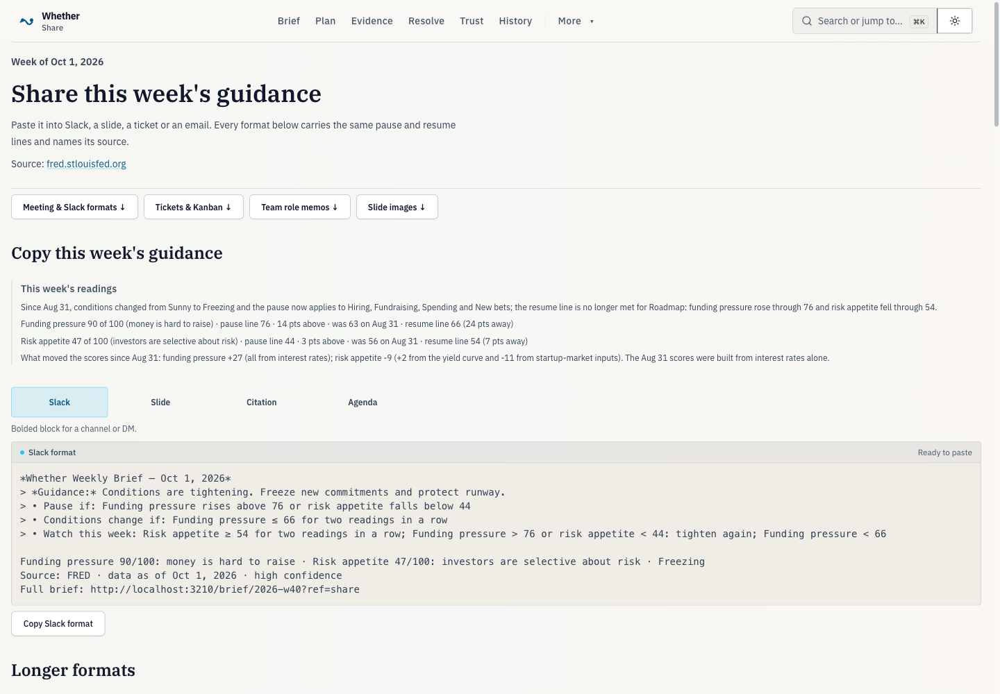
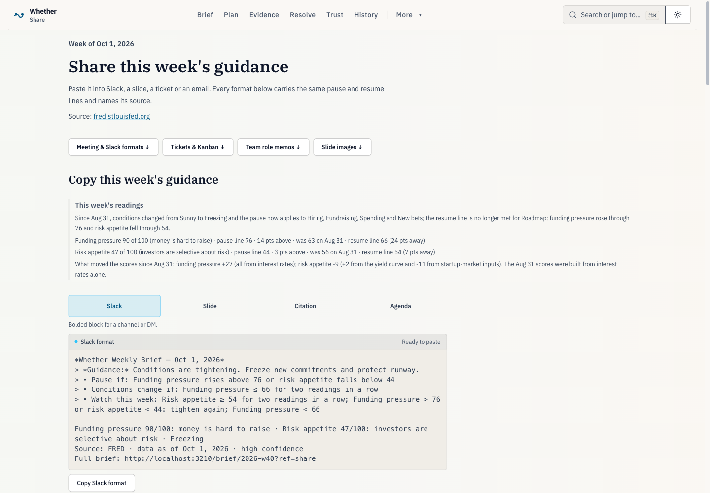
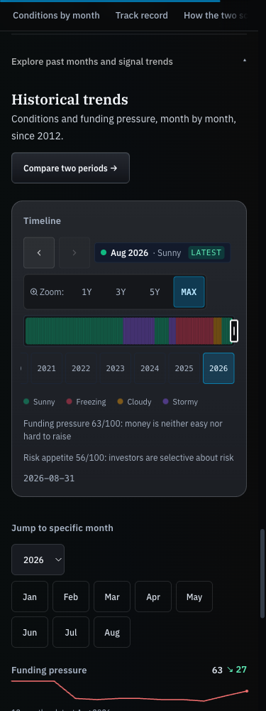
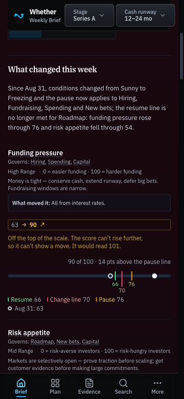

# Responsive page design review

**Evidence · 2026-10-04 · local Chromium at `http://localhost:3210`.**

The review covers the recently added visual navigation plus the responsive and spacing refinements. Screenshots use the local October 1 brief, settled fonts and themes, and disabled capture animations. They do not establish production or physical-device behavior.

## Findings and changes

| Finding | Change | Owning files |
| --- | --- | --- |
| Header controls competed with route navigation; small controls stayed small on tablets | Responsive search and labels, wrapping below 360px, pointer-aware compact sizing | `globalHeader*`, `styles/controls.css` |
| Child margins and repeated panel padding produced uneven section gaps and left edges | Shared page, section and card spacing roles | `styles/layout-shells.css`, report/home/share shells |
| Mobile signal rows could squeeze narrative text into a narrow column | Full-width stacked rows until `md`, fixed desktop signal columns | `WhatChangedSection`, `evidenceReaderSections`, `ui/areaTable` |
| Stage and runway options wrapped into uneven groups | Aligned labels and equal option cells; phone controls use the header | `WhatItChangesSection` |
| Share previews stretched to roughly 1,397px at desktop width | Centered 72rem page column, 48rem preview, equal tabs and phone jump-link grid | `share/page`, `briefFormatPicker` |
| Timeline zoom targets were 20–22px tall, month buttons 32px and track 36px on phones | 44px targets; compact controls only with a fine pointer and hover | `TimelineBar`, `styles/controls.css` |
| Some status labels and memo text were too small | Shared metadata and body type scales; wrapping memo header | `RunwayConditionedNotes`, `TimelineBar`, `commandPalette`, scenario/memo components |
| Radar caption described an operating pause distance despite projecting to a call-change boundary | Derive the distance from the plotted boundary; semantic ink in both themes | `RegimeRadar`, `regimeRadar.test` |

## Browser verification

- Nine routes at 320, 375, 640, 768, 1024 and 1440px: 54 cases without document overflow or header overlap. Routes: `/`, `/operate`, `/signals`, `/trust`, `/resolve`, `/share`, `/decisions`, `/history?explore=1`, and `/answers/should-startups-hire-engineers-right-now`.
- Five focused views at the same six widths with mouse and touch emulation: 60 cases without document or preview overflow. Views: expanded history, share, scenarios, financial planner and brief with critical-runway notes.
- Light and dark screenshots at 375 and 1440px. No page errors or console errors in these fresh browser contexts.
- Every timeline control and track measured at least 44px under touch emulation, including tablet widths. Zoom selection and keyboard month navigation worked.
- Slack, Slide, Citation and Agenda clipboard contents matched their previews, checked with both input modes.
- Planner checks used invented cash/spend/revenue figures of $600,000 / $200,000 / $50,000 in an isolated browser context. No messages were sent.

## Visual evidence

Desktop share page before the reading-width refinement:

Desktop share page after:

Mobile history after, with larger controls:

Mobile signal row after the full-width stack correction:

## Limits

Touch behavior was emulated in Chromium. Safari, physical devices and production rendering remain unverified. This change preserves report thresholds and export payloads; it changes presentation, control placement and the radar's displayed distance.
